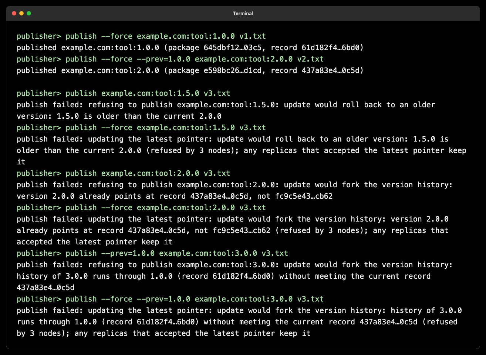
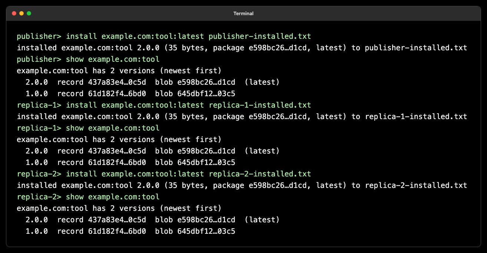
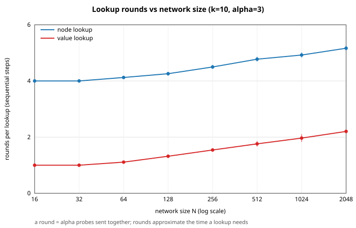
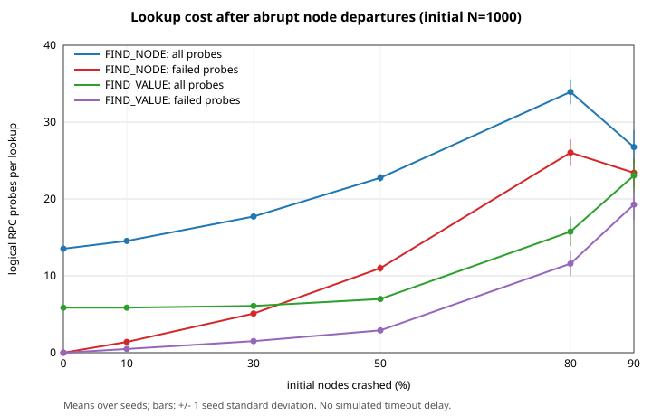
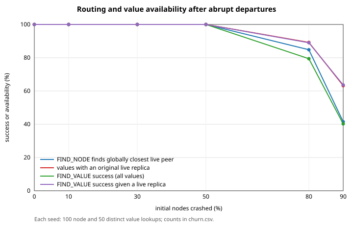

# D7024E Lab Report — Decentralized Package Registry

**Group 9:** Sungtae Kim, Jerald Jia Wei Lim, Arian Asghari

**Repository:** [ArianAsghari/d7024e](https://github.com/ArianAsghari/d7024e)

**Revision:** 16 October 2026; working tree based on `3488962`. Section 6.2 retains the earlier `e98c92d` container results.

## Summary

We implemented a decentralized package registry in Go. Part 1 is a Kademlia distributed hash table that stores content-addressed values over UDP. Part 2 adds domain-owned package names, Ed25519-signed version records and a mutable latest pointer that every node validates against rollback and forks. The `--force` command bypasses the publisher's proposed-update check while preserving validation at receiving nodes.

On the simulated network, lookup work grew slowly from 16 to 2048 nodes: 10.0–14.2 probes for nodes and 3.0–6.6 for values. At 50% per-leg packet loss, two retries raised value-lookup success from 83.7–84.5% to 99.7–99.9%. A 1000-node crash sweep retained 100% retrieval through 50% abrupt removal, with more routing work and fewer replicas; more severe removal caused retrieval failures, and one repair pass did not fully restore replication. The test suite passes with race detection and 93.4% combined statement coverage. Registry integration was also verified on a 50-container Docker Swarm.

## Contents

1. [Introduction](#1-introduction)
2. [Distributed storage](#2-part-1-distributed-storage)
3. [Signed package registry](#3-part-2-signed-package-registry), including [`--force`](#34-verified---force-behavior)
4. [Libraries and tools](#4-libraries-and-tools)
5. [Thread safety](#5-thread-safety)
6. [Testing and verification](#6-testing-and-verification)
7. [Experimental evaluation](#7-experimental-evaluation)
8. [Work beyond the minimum requirements](#8-work-beyond-the-minimum-requirements)
9. [Limitations and possible improvements](#9-limitations-and-possible-improvements)
10. [Reproduction and sources](#10-reproduction-and-sources)

## 1. Introduction

We built a decentralized package registry for D7024E Mobile and Distributed Computing Systems at Luleå University of Technology. Package files are distributed across participating nodes instead of one central server. Part 1 provides a Kademlia distributed hash table (DHT): a key-value store that finds data by a 256-bit identifier. Part 2 adds names such as `example.com:tool:1.0.0`, domain ownership, signed release records and a mutable pointer to the latest release. Each node checks that updates extend its accepted history, while clients verify who published a package and that its contents match the signed record.

A node is one running program instance. Kademlia uses **bitwise XOR** between identifiers, interpreting the result as an unsigned integer distance, to select nearby peers; this distance does not represent physical location. A lookup progressively learns contacts closer to its target. The parameters k and α control the desired replica count/bucket capacity and the number of concurrent lookup probes, respectively. Our defaults are k = 10 and α = 3.

This report follows the [lab specification](labs/LAB-SPEC.md) and [package-registry design](labs/PART2-DESIGN.md). It explains the implementation, concurrency controls and limits, then evaluates lookup scalability, resilience to packet loss and the integrated registry on containers.

## 2. Part 1: distributed storage

### 2.1 Components and data flow

`labs/main.go` assembles each node’s routing table, in-memory store, UDP listener, command shell or headless loop, and replication and refresh workers. The `kademlia` package owns routing, storage and iterative lookup. It depends on the `RPCClient` interface, implemented by the real UDP transport and by an in-process simulated network. The same lookup and storage code therefore runs in container demonstrations and large simulated tests.

The registry package contains signing, ownership, version validation and client operations behind a small `Backend` interface. `registry/dht` adapts that interface to Kademlia, using Store for immutable values, `StoreAt` for the mutable latest pointer, and `LookupData` for reads. `registry_cli.go` exposes the package commands. The registry validator is installed before the UDP listener starts.

The data path is: command → registry client when applicable → Kademlia lookup/storage → `RPCClient` → remote node. Incoming STORE requests validate values before changing local state. Maintenance workers reuse the same storage and lookup operations.

```text
CLI or headless loop (main.go, registry_cli.go)
├── put, get, ping, join, show rt, show ds ───────────────► kademlia
└── publish, install, keygen, show DOMAIN:PACKAGE
        │
        ▼
    registry (records, signatures, owners, version rules)
        │  Backend interface
        ▼
    registry/dht adapter ── Store, StoreAt, LookupData ──► kademlia
                         └─ installs the validator ─────► kademlia

kademlia: routing table, iterative lookup, storage, validator hook,
          replication and refresh workers
        │  RPCClient interface
        ├── real UDP transport (PING, STORE, FIND_NODE, FIND_VALUE)
        └── simulated network (seeded loss and latency, 1000+ nodes)
```

For readers who want to modify the system, this table maps the components to the source files.

| Location | Role |
| --- | --- |
| `labs/main.go`, `labs/registry_cli.go` | node assembly, configuration, CLI commands |
| `labs/kademlia/routingtable.go`, `bucket.go` | 256 k-buckets, recency order, eviction |
| `labs/kademlia/lookup.go`, `kademlia.go`, `value.go` | iterative lookups, storage, hash and validator checks |
| `labs/kademlia/maintenance.go` | replication and bucket-refresh workers |
| `labs/kademlia/network.go`, `simnetwork.go` | UDP transport and the seeded in-process simulated network |
| `labs/registry/` | records, signatures, ownership, version rules, publish and install client |
| `labs/registry/dht/` | adapter from the registry to Kademlia, and validator installation |
| `labs/experiment/`, `labs/cmd/experiments/`, `labs/scripts/analyze.py` | experiment runner and analysis script |
| `labs/Dockerfile`, `labs/docker-compose.yml` | container image and Swarm deployment |

### 2.2 Identifiers, routing and parallel lookup

A node ID is SHA-256 of its concrete IP:port string. Immutable data is stored under SHA-256(value). Both are 256 bits. The routing table uses the permitted b = 1 simplification: 256 fixed k-buckets. k defaults to 10 and is adjustable through `NewRoutingTable(me, k)`, which also controls the desired replication factor.

Distance is `d(x, y) = x XOR y`, using bitwise XOR on corresponding bits. In [`CalcDistance`](labs/kademlia/kademliaid.go), Go's `^` operator XORs corresponding bytes; `Less` compares the resulting 32-byte distances from the most significant byte, equivalent to ordering unsigned big-endian 256-bit integers. For a four-bit illustration, `1010 XOR 1011 = 0001` (1), whereas `1010 XOR 0010 = 1000` (8), so `1011` is closer to `1010`. The XOR operation is bitwise; the numerical interpretation orders its result. This follows the distance definition in Section 2 of the [original Kademlia paper](https://www.scs.stanford.edu/~dm/home/papers/kpos.pdf), using 256-bit IDs in place of the paper's 160-bit IDs.

Each bucket keeps contacts in recency order. A known contact moves to the most-recently-seen end. When the bucket is full, the node pings its least-recently-seen contact, retaining a responsive peer or replacing an unresponsive one. Protection against a contact being refreshed during that ping is described in Section 5.

Both node and value lookups proceed iteratively in rounds of up to α concurrent probes. α defaults to 3 and is adjustable through `ALPHA` or `SetAlpha`. A coordinator owns the candidate set, waits for the current batch, incorporates referrals and excludes failed peers. Each peer is queried at most once per lookup, apart from transport-level retries. Node lookup ends when the closest remaining candidates have been queried; value lookup may finish after a batch returns valid data. Waiting for the entire batch is our scheduling choice, not a requirement of Kademlia; Section 9.1 explains the reason, alternatives and trade-offs.

### 2.3 Storage and the UDP protocol

Store hashes a value, finds the closest candidates including the local node when appropriate, and attempts replication to up to k nodes. `LookupData` checks the local store before querying peers. Immutable values must pass the size and hash checks on both storage and retrieval. Incorrect bytes are rejected and reported. Valid immutable lookup results are cached locally; mutable registry pointers follow the separate rules in Section 3.

The transport implements PING, STORE, FIND_NODE and FIND_VALUE over UDP. A socket is a local operating-system endpoint used to send and receive datagrams. Each node binds one long-lived UDP listening socket for incoming requests. For each outgoing RPC, [`roundTrip`](labs/kademlia/network.go) calls `net.DialUDP("udp", nil, remote)`, creating a separate local UDP socket whose source address and ephemeral port are chosen automatically. Here **connected UDP** means that the local socket is associated with one remote IP:port; it involves no connection handshake or reliable session. Requests and retries leave through that socket. The remote node's listener sends the reply to the request datagram's source address/port, and the caller receives it on its temporary socket, then closes that socket when the RPC finishes. See Go's [`DialUDP` documentation](https://pkg.go.dev/net#DialUDP).

Separate outgoing sockets isolate concurrent reads and deadlines; UDP itself does not require one socket per RPC. A shared socket with a request-ID dispatcher could also work. Every RPC has a random 128-bit request ID, and its reply must match that identifier and the expected message type. An attacker unable to observe the request cannot feasibly guess its identifier; this is request correlation, not authentication of all network traffic.

The default deadline is 500 ms per attempt, with two retries, giving at most three transmissions. Retries retain the same ID and payload. Malformed replies and replies with a different ID are ignored until the current deadline. `RPC_TIMEOUT` sets the deadline at startup. A STORE acknowledgement is sent after validation/storage, so validation that fetches missing history can outlast the publisher’s deadline.

Every value is limited to 4096 bytes (4 KiB), including package files, which exceeds the required 255-byte minimum. JSON encodes the bytes as base64, expanding a maximum-sized value to 5464 characters before metadata. The wire encoder also checks the 65,507-byte IPv4 UDP payload ceiling. The conservative value limit followed a failed 32 KiB loopback trial on the development Mac; it does not eliminate fragmentation on a real network.

### 2.4 Joining, maintenance and commands

A joining node pings its bootstrap contact, adds it to the routing table and looks up its own ID. It then refreshes buckets farther away than its closest responsive neighbor by looking up random targets in those ranges. `BOOTSTRAP` performs this at startup; join IP:PORT exposes it to an already running shell. Hostnames resolve to the actual node address before the ID is derived.

A replication worker snapshots the local store and republishes values to the currently closest nodes, preserving explicit keys for mutable pointers. `REPLICATION_INTERVAL` defaults to one hour. Values have no expiration, as required. A separate worker refreshes each idle bucket range, including empty buckets, after `REFRESH_INTERVAL`, also one hour by default. It skips isolated nodes and records failed refresh attempts so they are retried after the interval.

The storage shell supports `ping IP:PORT`, `put FILENAME`, `get KEY [FILENAME]`, `show rt`, `show ds`, `exit` and `join IP:PORT`. Ping prints round-trip time; put prints the content key; get prints or writes the bytes and identifies the source or a local hit. Routing output omits empty buckets and abbreviates identifiers. Headless service containers run until signaled to stop.

## 3. Part 2: signed package registry

### 3.1 Data model, encoding and ownership

A release uses three linked objects. The package blob is stored under its content hash. An immutable version record binds that blob to a domain, package name and version, and points back to the previous version record. A signed latest pointer provides a stable, name-derived entry point to the history.

```text
Version record: {tag, domain-name, package-name, version, blobHash, previous-version-record, sig}
Latest pointer: {tag, domain-name, package-name, version, versionRecordHash, sig}
```

```text
latest pointer  (key SHA-256("domain:package:latest"); the only mutable entry)
   └──► record 1.2.0 ──► record 1.1.0 ──► record 1.0.0 ──► 64 zeros
            │                 │                │
            ▼                 ▼                ▼
        blob 3            blob 2            blob 1
```

Here "record" means version record. A new release adds a record at the head and moves the pointer. Every record and blob is stored under the SHA-256 of its own bytes.

The version-record key is SHA-256 of the complete canonical signed record. `previous-version-record` is a 64-digit lowercase hexadecimal hash, or 64 zeros for the first release. The pointer key is SHA-256("domain:package:latest"). This pointer is the intentional exception to content addressing: its key stays constant when its value changes.

Records are JSON objects with fixed field order and exact accepted spelling. Unknown fields, trailing data and non-canonical representations are rejected. Hashes and signatures use lowercase hexadecimal. Both record types sign the 32-byte SHA-256 digest of the canonical object without its `sig` member using Ed25519. Their distinct tags, version-record and latest-pointer, are included in the signed bytes, preventing a signature from being reused as the other record type.

`DomainOwners` abstracts ownership. `DNSOwners` expects exactly one relevant TXT record at the domain apex: `kademlia-pk=<standard padded base64 of the 32-byte public key>`, without whitespace. Unrelated TXT records are ignored; a missing or ambiguous owner is rejected. `StaticOwners` supplies the permitted fake DNS through a JSON domain-to-key table. Real TXT parsing is tested with an injected resolver; the container demonstrations use the shared static file, not a live DNS server.

Versions are numeric `MAJOR.MINOR.PATCH` triples with no signs or leading zeros, compared numerically, so `1.2.10` follows `1.2.9`. A successor must be strictly newer and extend the accepted record chain; consecutive numbers are not required. For example, `2.0.0` may be followed directly by `5.0.0` when the new record links to the accepted history. Course staff confirmed on 12 October that skipping numbers is intended, so this requires no code change. The meaning of a major, minor or patch increase is not enforced. Prerelease labels are unsupported, and `latest` is reserved. Domains must be lowercase DNS names; package names use lowercase letters, digits, dots, hyphens and underscores. Excluding colons makes `domain:package:version` unambiguous.

### 3.2 Validation, rollback and fork prevention

Every receiving node enforces the rules independently. The core’s `ValueValidator` callback receives the key, current accepted value and incoming value for a mutable update. It is also used to check mutable values returned by lookup. `StoreAt` publishes a value under an explicit key. The registry’s acceptance rules are:

- The pointer must decode canonically, match the key derived from its own domain/package, and verify under that domain owner’s public key.
- The referenced version record must be fetchable by hash, have a valid signature from the same owner, and agree with the pointer’s domain, package and version.
- Against an existing pointer, a lower version is a rollback. The same version naming a different record is a fork. An identical accepted head is an idempotent repeat after pointer validation.
- A newer version must have a valid chain of previous-record links reaching exactly the node’s accepted record. A history that branches elsewhere is a fork. Traversing backward must strictly decrease the version at every step, which rules out cycles.

A node that missed several releases fetches and validates missing records through `LookupData` until it reaches its stored head. A node with no prior state verifies the complete supplied chain back to the zero predecessor. Missing history causes `ErrMissingRecord` and leaves the old pointer intact. Traversal is bounded to 1000 records by default.

The latest pointer is structured because its signature must bind the target record to a particular domain, package and version. Repeating these fields prevents cross-package replay, permits early version comparison, and cross-checks the referenced record. Arbitrary labels such as “final” would not give replicas an objective order for detecting rollback. These protections are relative to a node’s known history; they do not implement global consensus.

### 3.3 Publication, installation and mutable reads

`publish [--force] [--prev=VERSION] DOMAIN:PACKAGE:VERSION FILENAME` first checks the proposed update with the real validator unless `--force` is supplied. Invalid ordinary publications are refused before upload. `--prev` chooses a predecessor explicitly, and `--force` permits an invalid proposal to reach the replicas for demonstration; it never disables receiving-node validation. Publication stores the blob, the signed record, and finally the signed latest pointer.

`install DOMAIN:PACKAGE:VERSION [FILENAME]` resolves `latest` or follows the history to a requested version, verifies the relevant signatures and checks the blob hash before writing the package. The default filename is `PACKAGE-VERSION`. `show DOMAIN:PACKAGE` prints the version chain; `show dns DOMAIN` displays the believed owner and fingerprint; `show ds` decodes records and pointers. `keygen DOMAIN` creates demonstration credentials.

A 50-container check exposed stale latest pointers on readers outside the k closest replicas: they cached an earlier pointer but did not receive later publications. The corrected implementation validates mutable lookup results without caching them. Only explicit STORE operations establish pointer replicas, and publishers do not force a local pointer copy. Immutable records and blobs remain cacheable. Repeated latest installs on non-replica readers therefore query the network again; a replica that missed a publication can still serve its older accepted pointer.

Publication consists of independent writes, not one transaction. A replica that accepts a pointer retains it even when another destination rejects or times out. A timeout can mean the outcome is unknown, since validation may finish after the publisher stops waiting. The CLI explains that accepting replicas keep their writes.

### 3.4 Verified `--force` behavior

The [lab specification](labs/LAB-SPEC.md) requires `--force` to bypass the publisher's proposed-update check. [`Client.Publish`](labs/registry/client.go) then uploads the immutable package and signed version record and attempts the latest-pointer STORE. **Receiving nodes still validate the update:** an invalid forced publication must reach the replicas and be rejected there. Syntax, file limits and signing-key requirements still apply. An explicit `--prev=VERSION` must identify an existing record whose hash can be included in the signed release.

#### Publication checks

The UDP regression, [`TestPublishForceOverUDP`](labs/registry_cli_test.go), first publishes `1.0.0` with `--force`, then `2.0.0` with `--force --prev=1.0.0`. Both valid updates succeed. It then attempts the following invalid updates with different package contents:

| Attempt after accepting `2.0.0` | Without `--force` | With `--force` |
| --- | --- | --- |
| Publish `1.5.0`, default predecessor | Local rollback refusal; no package uploaded | Package uploaded; pointer rejected by all three replicas as rollback |
| Publish `2.0.0` with different contents | Local fork refusal; no package uploaded | Package uploaded; pointer rejected by all three replicas as a same-version fork |
| Publish `3.0.0 --prev=1.0.0` | Local fork refusal; no package uploaded | Package uploaded; pointer rejected by all three replicas because the chain skips the accepted `2.0.0` head |
| Publish `2.0.0 --prev=2.0.0` | Local fork refusal; no package uploaded | Package uploaded; pointer rejected by all three replicas as a same-version fork |

Ordinary refusal reports `refusing to publish` before uploading either immutable object. Forced refusal reports `updating the latest pointer` and `refused by 3 nodes`, showing that the request reached receiver validation.



#### Accepted version is preserved

For every forced invalid attempt, the regression checks that the package bytes reached all three nodes while each stored pointer remains byte-for-byte unchanged. Installing `latest` returns the original `2.0.0` bytes. The demonstration also checks the installed file on every node.



The regression passes with the race detector. Simulated tests additionally cover wrong-owner rejection and invalid history.

The [transcript and test output](labs/experiments/force-results/README.md) provide the complete results.

### 3.5 Running the `--force` demonstration

From `labs/`, start the interactive runner (requires Go and Python 3):

```sh
./scripts/force-demo.sh --interactive
```

The runner prepares the keys and files and publishes `1.0.0` then `2.0.0`. At the `>` prompt, enter one command at a time:

```text
publish example.com:tool:1.5.0 v3.txt
publish --force example.com:tool:1.5.0 v3.txt
publish --force --prev=1.0.0 example.com:tool:3.0.0 v3.txt
show example.com:tool
install example.com:tool:latest installed.txt
exit
```

The first command reports `refusing to publish`; the next two report `updating the latest pointer` and refusal by three nodes. The chain remains `2.0.0 → 1.0.0`, and installation returns `2.0.0`.

Run `./scripts/force-demo.sh` without arguments for an automatic replay with file-byte checks. The [demonstration guide](labs/demo/FORCE-DEMO.md) includes further inputs and file-inspection steps. Section 10 includes the isolated regression command.

## 4. Libraries and tools

The application has no third-party Go module dependencies. `labs/go.mod` declares Go 1.22.1, and the container builder uses Go 1.22. Goroutines and channels support concurrent RPC handlers, lookup probes and maintenance workers. The Dockerfile builds with `CGO_ENABLED=0` and copies the standalone executable into an Alpine runtime image. Using the standard library keeps these mechanisms inspectable without a separate RPC framework.

- **UDP and JSON:** `net` provides UDP sockets, address resolution and the DNS TXT resolver. We use UDP because the lab explicitly requires it for RPCs, and implement request correlation, timeouts and retransmission ourselves as required. `encoding/json` gives us human-readable messages for inspection and a fixed encoding for registry records; strict canonical decoding makes the accepted record representation unique. `encoding/hex` represents hashes and signatures, and `encoding/base64` represents DNS public keys. JSON expands binary payloads as base64, adding overhead to our single-datagram transfers. Section 2.3 explains the 4 KiB value limit.
- **Cryptography:** `crypto/sha256` supplies content hashes, node identifiers and signing digests. `crypto/rand` supplies key-generation randomness, unpredictable request identifiers and random refresh targets. `crypto/ed25519` provides deterministic signatures with compact 32-byte public keys and 64-byte signatures. A public key occupies 44 characters in padded base64, fitting easily in the DNS TXT format without an extra cryptography dependency.
- **Data structures and concurrency:** `container/list` maintains bucket contacts in recency order; `sort` orders contacts by XOR distance. `sync` and `sync/atomic` protect shared state and counters. `context` and `time` control cancellation, maintenance intervals and deadlines. `math/rand` supplies seeded experiment inputs, and `hash/fnv` helps derive reproducible simulated transport draws.
- **Shell, files and testing:** `bufio`, `fmt`, `strings`, `io`, `os` and `path/filepath` support commands, configuration and files. `errors` preserves failure causes; `log/slog` emits structured lookup events. Go's `testing` package, race detector and statement-coverage tooling support verification.
- **Containers:** Docker runs one node per container; Docker Swarm supplies the overlay network and service scaling. One `kadlab` image provides the executable for the bootstrap and workers. We deployed one bootstrap plus 49 workers for the 50-container check.
- **Analysis:** the separate script, `labs/scripts/analyze.py`, uses only Python's standard library to parse event logs, compute statistics and generate CSV tables and SVG figures. This keeps the analysis reproducible without plotting dependencies. The original scalability and packet-loss figures are retained from their recorded sweep; the additional churn measurements are described in Section 7.4.

## 5. Thread safety

### 5.1 Values and concurrent validation

The CLI, UDP handlers, parallel lookups and maintenance workers may access a node concurrently. `Kademlia.dataMu` is a sync.RWMutex protecting the value map: writes take the exclusive lock and reads take a shared lock. Stored and returned byte slices are copied, and `Entries` returns a snapshot. Replication releases the lock before lookups and STORE RPCs.

Mutable validation runs outside the data lock on copied inputs. This is necessary because validation may fetch and cache immutable records through the same node. Before committing, `StoreValue` compares the current entry with the snapshot used for validation; if another writer changed it, validation repeats against the new state. This prevents a decision based on an obsolete head from overwriting a competing accepted update. Lookup acceptance uses the same state recheck while retaining only immutable data.

A matching-hash blob cannot overwrite an existing mutable pointer. Otherwise, the known string domain:package:latest could be uploaded under its own hash to bypass pointer validation. The registry validator has no mutable per-call state and supports concurrent and repeated evaluation. `StaticOwners` uses an RWMutex; the file-backed provider serializes reloads and replaces its owners file by temporary-file rename, preventing partial-file reads. This is not a cross-process transaction for simultaneous owner registrations. Private key files use mode 0600.

### 5.2 Buckets, lookup coordination and transport

Each bucket has its own RWMutex for contacts, eviction state and lookup timestamps. Readers copy contact structures before calculating distances; IDs are treated as immutable. A full bucket selects its oldest contact and observation sequence under lock, then releases the lock before PING. Only one eviction probe runs per bucket. A failed probe removes the contact only if its observation sequence is unchanged, so a concurrently received message prevents stale eviction.

Routing-table reads combine independent bucket snapshots rather than one atomic table snapshot. Each lookup’s coordinator exclusively owns its candidate map; workers only perform RPCs and return results through a buffered channel. `configMu` protects lookup configuration and validator changes, while lookup IDs use an atomic counter. The simulator locks shared maps and counters but releases locks before serving requests, allowing nested history lookups. Experiment-log writes are serialized.

`Network.mu` protects the listener, closed state and attached node. The receive loop copies each datagram before handing it to a goroutine. Outgoing calls use private buffers, sockets and request IDs. Handlers send their reply before updating routing state, since admitting a contact can trigger an eviction ping. Network identity and timeout/retry settings are fixed before concurrent use.

### 5.3 Maintenance and shutdown

Replication and refresh each run sequential passes in one worker. Idle-range checks and timestamp updates occur atomically under the bucket lock, which is released before a lookup. Context cancellation and a wait group stop both workers before the listener closes. Cancellation is checked between values or buckets; in-flight RPCs finish under their deadline/retry policy. A value lookup drains its current batch before returning. No data or bucket lock is held while waiting on network I/O or worker shutdown.

## 6. Testing and verification

### 6.1 Automated checks

We reran the complete six-package suite on **16 October 2026** with Go 1.26.3 on darwin/arm64, race detection and a fresh combined coverage profile. All tests passed with **93.4% combined statement coverage**, above the required 80%. Both 1000-node scenarios ran without short-mode exclusions, along with the new UDP force regression and churn-runner tests. `go vet ./...`, the node build and the Python analyzer's availability/routing accounting test also passed. These checks cover the revised working tree identified at the start of this report. The container results below remain the historical `e98c92d` integration run; we did not recreate that stack for this revision.

Tests cover routing and bucket eviction, join and refresh ranges, replica restoration after churn, α bounds and overlapping probes, size limits, hash checks, event logging and cancellation. Real loopback UDP tests cover message correlation, multi-peer lookups, maximum-sized values, fetching history during validation, late STORE completion after a timeout and acknowledgement with a longer deadline. Race detection checks exercised execution paths; it is not a proof of every possible interleaving.

The suite includes two 1000-node simulated scenarios. The DHT test exercises joining, node/value lookup, storage, 10% node removal and packet loss. The registry test publishes releases from different nodes, rejects wrong owners, rollback, forks, cycles and tampered pointers, catches up a replica that missed releases, and checks installation of current and old versions from 25 fresh readers. Regressions also require non-replica readers and publishers to observe a valid successor without retaining stale mutable copies.

### 6.2 Integrated 50-container checks

We rebuilt the image from `e98c92d` and recreated the stack on 11 October 2026: one bootstrap plus 49 worker containers on one Docker host. Demonstration clients joined the same overlay network. Every service mounted the named volume at `/shared` and used `OWNERS_FILE=/shared/owners.json`; private keys remained separate per container. The following results describe that rebuilt stack.

- Valid publication and retrieval: owner publications succeeded; a keyless reader installed latest and a historical release. An unknown version returned an error. The chain, DNS-owner and decoded-store commands displayed the expected information.
- Invalid updates: forced rollback, a forced fork from an earlier release and a wrong-owner publication were refused by all ten pointer replicas. Ordinary invalid publication was refused by the client before upload.
- **Latest-pointer regression:** two different readers installed a new latest version after another publication, observing `1.1.0` → `1.2.0` and `1.2.0` → `1.3.0`. Our earlier run on `3611512` exposed stale read caches on non-replicas. The fix in `dca4a65` stops reads from retaining mutable pointers; the rebuilt `e98c92d` run did not reproduce that defect.

We used the rebuilt stack for two short deadline comparisons:

*Table 1. Publication timeouts in the rebuilt 50-container stack.*

| RPC deadline per attempt | Consecutive publications | Reported STORE timeouts |
| --- | --- | --- |
| 500 ms | 8 | 2 |
| 2 s | 8 | 0 |

We then installed from a fresh reader and saw all 20 releases, `1.0.0` through `1.19.0`, including both publications that had reported timeouts. A timeout therefore does not imply that the update was absent. This observation does not establish the final state of every replica. The small comparison supports a 2 s publisher deadline for this demonstration, not a guarantee against future timeouts. Fetching history during validation is a plausible explanation for delayed acknowledgements, but we have no timing trace establishing the cause of those individual delays.

## 7. Experimental evaluation

### 7.1 Method and measurement definitions

The two required experiments use the [committed results](labs/experiments/results/summary.md), produced by the Go experiment runner and the external Python analysis script. Networks are generated from distinct random IP:port pairs hashed into IDs. Nodes join through randomly selected existing nodes using the normal join procedure. Random publishers store random values of 16–256 bytes. Seeds 1–10 are used for each configuration, with a separate seeded generator choosing measurement inputs.

Logging begins only after joining and initial storage, excluding setup work. Initial readers are chosen from nodes that do not already store the selected key. `lookup_probe` and `lookup_complete` events record logical RPC probes, batch rounds and success/failure. Retransmissions are excluded from logical probe counts. A successful value lookup must return bytes that pass the hash check; node results are also checked against the true closest ID computed from all simulated nodes, excluding the initiator.

The analyzer calculates one mean or success rate per seed, then reports the mean and sample standard deviation across ten seeds. Tables and error bars show mean ± one standard deviation, not a confidence interval. The variance is the square of that standard deviation. These measure variation between runs rather than variation between individual lookups.

The simulator supports configurable latency, per-leg packet loss and retries. These mandatory runs use virtual delivery without injected delays, no churn during measurement, and no periodic maintenance workers; replication/refresh intervals therefore do not affect them. Requests and replies can be lost independently. Simulated retries model delivery attempts without waiting for the real transport’s timeout. Round counts are a rough latency proxy, not measured wall-clock time. Seeds fix random inputs but not every concurrent scheduling decision.

### 7.2 Experiment 1: lookup scalability

Question: how does lookup work grow with network size? For N = 16, 32, 64, 128, 256, 512, 1024 and 2048, each of ten seeds measures 50 node and 50 remote value lookups, with k = 10, α = 3 and no loss: 8000 lookups in total. Kademlia’s progressive reduction in XOR distance suggests approximately logarithmic growth, while probing several close candidates adds work beyond a single chain of sequential hops.


*Figure 1. Mean logical probes versus network size. Error bars show ±1 standard deviation across ten seeds; dashed lines are least-squares fits against log₂(N).*

*Table 2. Logical probes (mean ± standard deviation) and mean rounds per lookup.*

| Nodes N | Node probes mean ± SD | Value probes mean ± SD | Node rounds | Value rounds |
| --- | --- | --- | --- | --- |
| 16 | 10.0 ± 0.0 | 3.0 ± 0.0 | 4.00 | 1.00 |
| 32 | 10.0 ± 0.0 | 3.0 ± 0.0 | 4.00 | 1.00 |
| 64 | 10.5 ± 0.1 | 3.3 ± 0.1 | 4.12 | 1.11 |
| 128 | 11.1 ± 0.1 | 4.0 ± 0.2 | 4.26 | 1.32 |
| 256 | 12.0 ± 0.3 | 4.6 ± 0.2 | 4.50 | 1.54 |
| 512 | 12.9 ± 0.2 | 5.3 ± 0.3 | 4.78 | 1.76 |
| 1024 | 13.4 ± 0.3 | 5.9 ± 0.4 | 4.92 | 1.97 |
| 2048 | 14.2 ± 0.3 | 6.6 ± 0.2 | 5.17 | 2.20 |

Node-lookup probes grow from 10.0 to 14.2, while value-lookup probes grow from 3.0 to 6.6. Fitted growth is 0.65 and 0.55 probes per doubling of N, with R² = 0.971 and 0.967 respectively. Node lookups show a floor near k = 10 because termination queries the closest candidates; value lookup can stop after its first successful batch. All 8000 lookups succeeded, and every recorded node lookup found the true closest node. The results are consistent with logarithmic growth over this range, without establishing behavior for arbitrary topologies or network sizes.



*Figure 2. Mean lookup rounds versus network size, with ±1 standard deviation across ten seeds. One round contains up to α parallel probes; it is not a measured wall-clock duration.*

Mean node-lookup rounds grow from 4.00 at 16 nodes to 5.17 at 2048; value-lookup rounds grow from 1.00 to 2.20. Comparing Figures 1 and 2 separates total RPC work from sequential batches. Parallel requests may reduce rounds without reducing total probes.

### 7.3 Experiment 2: lookup reliability under packet loss

Question: how does packet loss affect retrieval success? Each 500-node network stores 20 random values before loss is enabled, then measures 100 value lookups. The sweep uses seven per-leg loss rates from 0% to 50%, α = 1 or 3, and zero or two retries. Ten seeds per configuration yield 28,000 lookups. All variants initialize without loss before applying their measurement settings. Successful retrievals add immutable cached copies, so these are sequential queries on an evolving cache.

With independent per-leg loss p, a single request/reply attempt completes with probability (1 − p)². With two retries, at least one of three attempts completes with probability 1 − [1 − (1 − p)²]³. Replicas and alternative contacts provide further chances to find data. We therefore expect success to fall as loss rises, and retries to improve reliability; this calculation is an RPC expectation, not a complete lookup model. The dashed reference curves in Figure 3 use `1 − (1 − q)^k`, where `q` is the probability that an RPC completes with the selected retry count. This simplified model assumes all k replicas can be contacted directly and independently. Actual lookups must first discover reachable replicas and evolve their caches, so the model is neither a fitted prediction nor a guaranteed bound.


*Figure 3. Value-lookup success under independent request/reply loss. Points are means over ten seeds, bars show ±1 standard deviation, and dashed curves show the simplified replica-failure model. The vertical axis starts at 70%.*

*Table 3. Success rate (%) ± standard deviation in percentage points across ten seeds.*

| Per-leg loss | α = 3, 2 retries | α = 1, 2 retries | α = 3, 0 retries | α = 1, 0 retries |
| --- | --- | --- | --- | --- |
| 0% | 100.0 ± 0.0 | 100.0 ± 0.0 | 100.0 ± 0.0 | 100.0 ± 0.0 |
| 5% | 100.0 ± 0.0 | 100.0 ± 0.0 | 100.0 ± 0.0 | 100.0 ± 0.0 |
| 10% | 100.0 ± 0.0 | 100.0 ± 0.0 | 100.0 ± 0.0 | 100.0 ± 0.0 |
| 20% | 100.0 ± 0.0 | 100.0 ± 0.0 | 100.0 ± 0.0 | 99.9 ± 0.3 |
| 30% | 100.0 ± 0.0 | 100.0 ± 0.0 | 99.7 ± 0.7 | 99.8 ± 0.4 |
| 40% | 100.0 ± 0.0 | 100.0 ± 0.0 | 97.1 ± 1.4 | 95.2 ± 1.8 |
| 50% | 99.7 ± 0.5 | 99.9 ± 0.3 | 83.7 ± 3.7 | 84.5 ± 2.6 |

At 50% per-leg loss, α = 3 with two retries achieves 99.7% ± 0.5 percentage points, compared with 83.7% ± 3.7 without retries. The corresponding α = 1 results are 99.9% ± 0.3 and 84.5% ± 2.6. Differences between α settings are small relative to the observed spread and do not establish that either is more reliable.

Parallelism also changes the amount of work. At zero loss with two retries, α = 3 averages 5.1 logical probes over 1.7 rounds, versus 1.8 probes over 1.8 rounds for α = 1. At 50% loss those figures are 6.2/2.1 and 3.4/3.4. A complete parallel batch runs even when one response already has the value, increasing probes while potentially reducing sequential rounds. Neither metric counts retransmissions or real timeout delays.

The main limits are independent loss after healthy setup, small in-memory values and evolving caches. Correlated loss, lossy joins, concurrent churn, real timeout delays and larger packages could change the outcome. The original 1000-node churn test is a correctness check, not a performance result. Section 7.4 adds quantitative crash-burst measurements. The original scalability and loss sweep was retained for this revision; the new checks do not constitute a rerun of those measurements.

### 7.4 Experiment 3: effects of abrupt departures from 1000 nodes

#### Method

The earlier 1000-node test retrieved 30 values after removing 100 nodes, but recorded no comparative churn measurements. We therefore ran [`RunChurn`](labs/experiment/churn.go), retaining the [raw measurements, CSV tables and plots](labs/experiments/churn-results/). Each of six removal fractions (0%, 10%, 30%, 50%, 80%, 90%) uses ten independently built 1000-node networks, seeds 1–10, k = 10 and α = 3. Each network joins and stores 50 distinct values while healthy. A separate seeded random permutation chooses the nodes removed simultaneously, without graceful departure notifications. There are no new arrivals, packet loss, injected latency, retry delays or periodic workers. This measures a **crash fraction**, not a continuous churn rate.

After removal, each run measures 100 node lookups against the globally closest *live* peer (excluding the initiator), then reads each of the 50 values once from a surviving non-holder. The total is 6000 node and 3000 value lookups. Original live copies are counted before reads, so an unavailable value can be distinguished from failure to route to a surviving copy. Each key has only one measured read per network; later reads of that same key cannot benefit from a measurement-created cache. Successful reads do create immutable caches, and routing tables evolve during the sequential workload. Counts include both successful and failed lookups.

#### Lookup cost and availability

*Table 4. Results after departures. Each row pools 1000 node and 500 value lookups across ten seeds. Probe cost is mean ± sample SD of per-seed means; copy counts are means over all 500 values immediately after the crash.*

| Removed | Live nodes | True closest live peer found | Values found | Node probes mean ± SD | Original live copies/value |
| --- | --- | --- | --- | --- | --- |
| 0% | 1000 | 1000/1000 | 500/500 | 13.53 ± 0.15 | 10.00 |
| 10% | 900 | 1000/1000 | 500/500 | 14.55 ± 0.35 | 9.05 |
| 30% | 700 | 1000/1000 | 500/500 | 17.72 ± 0.38 | 6.99 |
| 50% | 500 | 1000/1000 | 500/500 | 22.75 ± 0.51 | 4.98 |
| 80% | 200 | 848/1000 | 397/500 | 33.93 ± 1.63 | 1.87 |
| 90% | 100 | 415/1000 | 201/500 | 26.75 ± 2.21 | 0.93 |



*Figure 4. Mean logical probes, including failed RPCs, after abrupt departures. Bars show ±1 SD across seeds. Failed simulated RPCs return without real timeout waiting; this plot measures work, not elapsed latency.*

Up to 50% removal, every measured lookup succeeded, but this resilience had a cost: node probes increased from 13.53 to 22.75, with 10.99 failed probes per lookup at 50%; node rounds increased from 4.96 to 8.61. Mean original copies fell from 10 to 4.98, reducing the margin against further departures. Value probes increased from 5.86 to 6.99. Thus success alone would hide both extra routing work and lost redundancy.



*Figure 5. Observed closest-peer accuracy, value availability and retrieval success. Rates pool the measured lookups at each removal fraction. Conditional retrieval success considers only keys with at least one original live replica.*

At 80% removal, 54 of 500 values lost every original copy, while another 49 remained stored somewhere but were not found; retrieval succeeded for 397/500 (79.4%), or 397/446 (89.0%) of values with a live copy. At 90%, 184 values lost all copies and another 115 surviving values were not found, giving 201/500 (40.2%) overall and 201/316 (63.6%) conditional success. These are distinct failures: replication cannot recover a value after every copy disappears, whereas a routing miss leaves data present but undiscovered. Node-lookup accuracy also fell to 84.8% and 41.5%. The lower node-probe count at 90% than 80% removal is consistent with earlier exhaustion of reachable candidates; it does not demonstrate better efficiency. Value probes continued rising, reaching 23.04 and 8.16 rounds at 90%.

#### Replica repair

We then tested repair by calling the production `Republish` function once on selected original surviving holders: one source per retained key, selected before reads, with duplicate source nodes called only once. This is a controlled manual maintenance pass, not a measurement of the periodic timer or recovery time. A read can already have added one cached copy, so the before-repair snapshot and after-repair totals in the [full results](labs/experiments/churn-results/summary.md) distinguish those stages. Values with no original survivor remained lost. For retained values:

*Table 5. Repair outcomes. Copy means weight seeds equally, averaging each seed's retained values; final-column counts pool retained values. Total live copies include read caches; closest-node placement is checked independently against all surviving IDs.*

| Removed | Total live copies after repair/retained value | Copies at actual closest k/retained value | Retained values present at all k closest |
| --- | --- | --- | --- |
| 0% | 11.00 | 10.00 | 500/500 |
| 10% | 10.67 | 9.67 | 381/500 |
| 30% | 8.92 | 7.87 | 65/500 |
| 50% | 6.95 | 5.78 | 9/500 |
| 80% | 4.23 | 2.91 | 0/446 |
| 90% | 3.12 | 2.19 | 0/316 |

All joins and manual republish calls returned without errors, yet one pass did **not** restore k copies or correct placement for every retained key. The publisher chooses from discovered contacts; successful writes to those destinations do not prove global k-replica coverage. This reveals a maintenance limitation that the small restoration test does not expose. Refreshing routing knowledge, trying farther known peers after nearer contacts fail, and repeating maintenance are candidates for further evaluation; their recovery effectiveness was not measured here.

#### Scope and reproducibility

These results apply to random simultaneous crashes after healthy setup, with sequential queries and immediate simulated failures. They do not establish behavior under correlated failures, continuous arrivals/departures, UDP timeout latency, or a running refresh/replication schedule. Seeds fix addresses, workload and removal sets; join refresh targets use cryptographic randomness and goroutine scheduling can vary, so reruns need not reproduce every probe count exactly. The retained raw measurements and analyzer reproduce the reported tables without rerunning the networks.

## 8. Work beyond the minimum requirements

We added `join IP:PORT` to attach a running node without restarting it, `keygen DOMAIN` to prepare demonstration credentials, and an optional install output filename. These additions make ownership and multi-node scenarios easier to demonstrate.

Beyond the two required experiment questions, we compare α and retry policies. At 50% loss without retries, α = 3 uses 4.0 rounds rather than 9.9 for α = 1, while using 11.7 rather than 9.9 logical probes: about 2.5 times fewer rounds for 1.2 times as many probes. The observed success-rate differences do not establish a reliability advantage for either α. Instrumentation also records elapsed time, cache hits and exact-target discovery. Our separate container deadline comparison investigates publication acknowledgements and partial outcomes.

We implemented an injectable real DNS TXT resolver in addition to the allowed static owner table, enabling offline tests and future live-DNS use. Strict canonical decoding, bounded history walks, configurable RPC deadlines and targeted concurrent-update/late-acknowledgement regressions add robustness. Seeded multi-run experiments, the simulator, 1000-node tests and operation under churn are engineering requirements; we do not count them as optional extensions.

## 9. Limitations and possible improvements

- **Persistence and size:** stores are in memory; loss of every copy loses the data. Disk persistence would improve restart recovery. The 4 KiB value limit constrains real packages. Chunking or a separate TCP data plane would support larger files and reduce reliance on fragmented UDP datagrams.
- **Replica repair:** Section 7.4 shows that a single republish pass after abrupt departures can leave fewer than k live copies and incomplete placement, even without a returned error. Better discovery of replacement peers and evaluation of repeated refresh/replication passes are needed before claiming full recovery under churn.
- **Freshness and consistency:** a replica that misses an update may serve its old accepted pointer. A new node cannot detect a fork predating its first contact, and a non-replica reader keeps no mutable history checkpoint. Independent accepted histories are not reconciled by consensus. Explicit consistency rules and retained trust checkpoints would be needed for stronger guarantees.
- **Publication outcomes:** writes can partially succeed, and a timeout does not distinguish rejection from late completion. `LookupData` also cannot always distinguish an absent value from exhausted or unreachable peers. Better outcome reporting, bounded asynchronous validation and explicit retry/recovery rules would improve operability.
- **Ownership and history:** there is no key rotation. Every record is checked against the domain's current public key, so replacing it invalidates signatures made with the previous key. Key transitions and authenticated history checkpoints would need further design.
- **Owner-source availability:** there is no registry-level cache of DNS owner keys. Each validation queries its owner source; `DNSOwners` uses a 5 s timeout by default. The local file provider does cache the parsed table and reloads it when the file changes. Live DNS deployment and its trust configuration were not evaluated in the container demonstration.
- **Single-host fake DNS:** the named volume containing the owners file is shared on one Docker host, not a cross-host filesystem. It assumes trusted administration and is suitable for our single-host demonstration. A multi-host deployment needs real DNS or another shared ownership service.
- **History and version limits:** a walk can inspect at most 1000 records by default. Validation or catch-up that requires a longer walk rejects the pointer; a node with a recent accepted head may stop at that checkpoint. Numeric version gaps are allowed, but prerelease labels and the semantic meaning of version bumps are not implemented.
- **Concurrency and load:** α limits one lookup rather than all requests at a node. A refresh scan can initiate up to 256 sequential lookups, delaying later passes or shutdown. A node-wide request budget and bounded cancellation would help under sustained load. Section 9.1 discusses lookup scheduling separately.
- **Evaluation scope:** the container run was on one host, and the simulator omits real timeout delays in the mandatory experiments. Section 7.4 measures abrupt departures, not sustained join/leave rates. Experiments with multiple hosts, correlated loss, lossy joins and continuous churn would give stronger deployment evidence.

### 9.1 Why lookups wait, and an alternative

Our [`lookupRound`](labs/kademlia/lookup.go) uses **strict parallelism**, an approach permitted by the lab: it launches at most α workers, then receives exactly one result from every worker before returning the batch to the coordinator. Consequently even a fast valid value response waits for a slow peer's response or final timeout. This structure gives the coordinator sole ownership of candidate state and ensures that no lookup RPC outlives its call, making concurrency and shutdown simpler. It introduces a barrier: one failed peer can delay progress through all three attempts, approximately 1.5 s with the default 500 ms deadline. Kademlia does not require this barrier. The [original paper, Section 2.2](https://www.scs.stanford.edu/~dm/home/papers/kpos.pdf), permits the next lookup step before all previous replies arrive; the [lab-linked design specification](https://xlattice.sourceforge.net/components/protocol/kademlia/specs.html) distinguishes scheduling approaches.

A useful alternative is an event-driven coordinator with at most α RPCs in flight. It processes each response immediately, adds closer candidates and fills an available slot without waiting for the other requests. Value lookup can return on the first **validated** value. Node lookup still needs a convergence condition: a fast response alone does not establish the closest nodes, and pending responses that could change the final closest set must be resolved or timed out. This can retain a single owner of lookup state. It would require cancellation-aware RPCs, deadlines and cleanup for outstanding calls; our current `RPCClient` interface has no cancellation parameter. Returning early without cleanup leaves background work consuming sockets and goroutines. A permanently slow request also occupies a slot until completion or cancellation, so a bounded pipeline reduces the barrier but cannot eliminate every wait.

| Policy | Smaller α | Larger α |
| --- | --- | --- |
| Current full-batch wait | Less speculative traffic, but more sequential rounds and greater dependence on each chosen peer. At α = 1 there is no alternative request running during a stall. | More paths are explored together and fewer rounds may be needed, but every batch still waits for its slowest request. A larger batch also has more chances to include a slow peer. |
| Process responses as they arrive, cap in-flight work at α | Lower instantaneous load, but fewer slots remain productive when a peer stalls. | More fast responses can advance the lookup while others remain pending, at the cost of more simultaneous work and potentially redundant probes. Outstanding calls need cleanup on completion. |

Neither increasing α nor removing the barrier guarantees fewer probes or lower latency in every topology. Larger α spends bandwidth, sockets and remote capacity to reduce dependence on individual paths; under heavy load it can itself create delay. Our measured packet-loss results illustrate the work/round trade-off, but contain no RPC delay measurements and do not compare schedulers. A fair follow-up would compare both policies at fixed α under heterogeneous latencies and failures, measuring median/tail latency, total transmissions and peak in-flight work across concurrent lookups. The asynchronous policy is a proposed improvement, not an implemented or measured result in this report.

## 10. Reproduction and sources

### 10.1 Automated checks

Run the automated checks from `labs/`. The coverage command measures all packages together, avoiding averages of separate package percentages:

```sh
go test -race -count=1 -coverpkg=./... -coverprofile=coverage.out ./...
go tool cover -func=coverage.out
go vet ./...
go build -o /tmp/kadlab .
```

To check `--force` independently or replay the demonstration:

```sh
go test . -run '^TestPublishForceOverUDP$' -race -count=1 -v
./scripts/force-demo.sh
```

### 10.2 Experiments

To rerun the original scalability and packet-loss sweeps without overwriting their recorded artifacts, from `labs/`:

```sh
go run ./cmd/experiments -exp scalability -out experiments/reproduced-results
go run ./cmd/experiments -exp reliability -out experiments/reproduced-results
python3 scripts/analyze.py experiments/reproduced-results
```

To reproduce the new 1000-node departure sweep and its analysis:

```sh
go run ./cmd/experiments -exp churn -seeds 10 -workers 4 -out experiments/churn-results
python3 scripts/analyze.py experiments/churn-results
python3 -m unittest discover -s scripts -p 'test_analyze.py'
```

The analyzer can regenerate the churn tables and plots directly from the retained `churn.jsonl`. `-quick -seeds 1 -out /tmp/kademlia-experiment-smoke` provides a smaller runner smoke test; it does not reproduce the full measurements.

### 10.3 Container deployment

For the single-host container deployment, initialize Docker Swarm if necessary, then build and deploy from `labs/`. The scale command gives one bootstrap plus 49 workers. `RPC_TIMEOUT=2s` is the setting supported by the short registry comparison:

```sh
docker build -t kadlab:latest .
RPC_TIMEOUT=2s docker stack deploy --resolve-image never -c docker-compose.yml kademlia
docker service scale kademlia_kademliaNodes=49
```

Interactive demonstration nodes must join `kademlia_kademlia_network`, mount `kademlia_registry_shared` at `/shared`, set `OWNERS_FILE=/shared/owners.json`, use their own `KEYS_DIR`, set `BOOTSTRAP=bootstrap:8000`, and set `RPC_TIMEOUT=2s` for the publisher comparison. The publisher must retain its private key between releases. Detailed commands and configuration are in the [running guide](labs/RUNNING.md).

### 10.4 Sources

The report draws on the [lab specification](labs/LAB-SPEC.md), [Part 2 design](labs/PART2-DESIGN.md), [source code](labs/), [original experimental results](labs/experiments/results/summary.md), [new churn measurements](labs/experiments/churn-results/summary.md), the [Kademlia paper](https://www.scs.stanford.edu/~dm/home/papers/kpos.pdf), the [lab-linked parallelism specification](https://xlattice.sourceforge.net/components/protocol/kademlia/specs.html), and [Go's UDP API documentation](https://pkg.go.dev/net#DialUDP). Team notes dated 11–12 October supply the historical container observations. The 16 October revision adds the real UDP force regression and the retained churn dataset; it does not claim a new 50-container demonstration.
