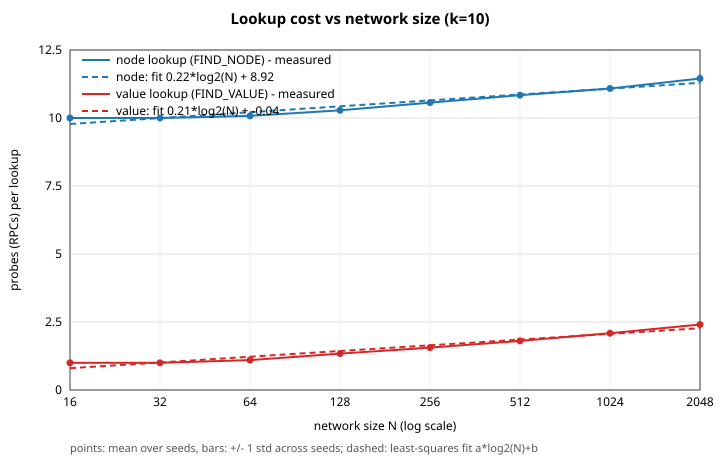
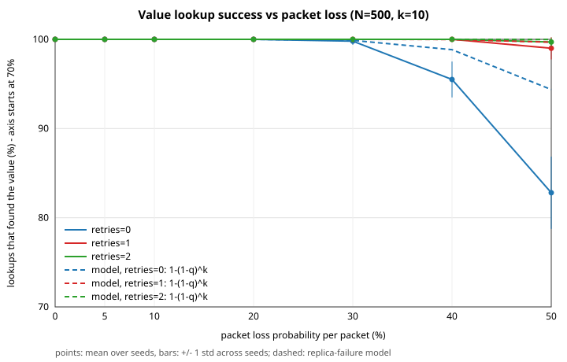

# D7024E Lab Report — Kademlia DHT

**Group number:** 9
**Group members:** Sungtae Kim, Jerald Jia Wei Lim, Arian Asghari
**Repository:** https://github.com/ArianAsghari/d7024e (shared development branch: `Sprint-2`)

## Frameworks and tools

- Go 1.22 — standard library only so far, no external dependencies
- Docker + Docker Swarm for containerization
- `crypto/sha256` for content hashing and node ID derivation

## System architecture overview

We are implementing the Kademlia DHT as specified in the course's `LAB-SPEC.md`, using 256-bit (SHA-256) node IDs and keys.

- **Node identity**: each node's ID is derived as `SHA-256(IP:port)`, computed at startup from the container's own network address.
- **Routing table**: a fixed array of 256 k-buckets. Each bucket holds up to *k* contacts (default 10, configurable). Existing contacts move to the most-recently-seen end. A full bucket PINGs its least-recently-seen contact, retaining it if responsive and replacing it if unresponsive.
- **Core algorithm** (`kademlia.go`, `lookup.go`): implements iterative node and value lookups in rounds of up to alpha concurrent probes (default 3; adjustable through `ALPHA` or `SetAlpha`). Each peer is queried at most once; candidates are owned by the coordinator, which incorporates RPC results between rounds. Value lookup checks size and `SHA-256(value) == key` before caching. `Store` replicates to the *k* closest nodes.
- **Mutable-value extension** (`value.go`): non-content-addressed values require an installed `ValueValidator`. The callback receives the key, current value, and incoming value; only acceptance permits replacement. `StoreAt` publishes under an explicit key, and replication preserves that key. The installed registry callback fetches missing immutable records with `LookupData` before accepting an update. Remote lookup results share the same validation, but only immutable results are cached. Mutable pointers are retained through STORE, so non-replica readers and publishers do not create copies that later publications would miss.
- **Network layer** (`network.go`): the four RPCs (PING, STORE, FIND_NODE, FIND_VALUE) are defined behind `RPCClient`, so the transport can be replaced for simulated tests. The real implementation uses UDP, JSON serialization, random request IDs, response correlation, and configurable timeouts/retries.
- **Simulated network and experiments** (`simnetwork.go`, `experiment/`): in-process nodes use the same core through `RPCClient`, with configurable latency, per-packet loss, retries, and seeds. Nodes join through the normal bootstrap procedure. The experiment runner records the nodes' own lookup events for analysis by a separate Python script.
- **Joining** (`maintenance.go`): contact a bootstrap node, insert it into the routing table, look up our own ID, and perform lookups for random IDs in every bucket farther away than the closest responsive neighbor. Bucket 0 is the farthest range in our implementation. Startup accepts `BOOTSTRAP=IP:PORT`; the CLI also supports `join IP:PORT`.
- **Periodic replication** (`maintenance.go`): one worker per node periodically copies its local store and republishes those values to the current closest nodes. `REPLICATION_INTERVAL` defaults to one hour. Local values have no TTL and are never removed by this worker.
- **Periodic routing refresh** (`maintenance.go`): a separate worker scans for buckets with no outgoing lookup in their range for `REFRESH_INTERVAL` (default one hour). It looks up a random ID in each idle range, including empty buckets, and skips isolated nodes. A failed refresh advances the attempt timestamp and is retried after the interval.
- **Instrumentation** (`lookup.go`): JSON probe and outcome events correlate by node ID and lookup ID. Outcomes include success, errors, logical probe counts, rounds, elapsed time, local cache hits, and exact-target discovery. Retransmissions are excluded from logical probe counts.
- **CLI** (`main.go`, `registry_cli.go`): supports `ping`, `join`, `put`, `get`, `show rt`, `show ds`, `exit`, `keygen`, `publish`, `install`, `show DOMAIN:PACKAGE`, and `show dns DOMAIN`. Registry validation is installed before the UDP listener starts. Headless container nodes run until signaled to stop.
- **Containerization**: each node runs as a separate Docker container from a single image (`kadlab`), deployed via Docker Swarm (`docker stack deploy`). We've verified containers can reach each other over the Docker overlay network and tested scaling to 50 replicas.

## Current status (registry integrated)

**Done:**
- Docker build + multi-container deployment; verified node-to-node connectivity and scaling to 50 nodes
- Node ID generation via `hash(IP|port)`
- All three Sprint 1 PRs merged; the shared Sprint 2 branch includes core, UDP networking, and CLI
- Core lookup, store, and value retrieval with hash verification
- PING-based full-bucket eviction, including concurrent contact-refresh protection
- Bootstrap, self-lookup, and join-time bucket refresh
- Periodic replication with configurable interval and cancellation; no expiration
- Adjustable alpha-parallel node and value lookup (default 3)
- Periodic idle-bucket refresh with cancellation
- A 4096-byte value limit enforced at store and retrieval boundaries
- JSON lookup probe/outcome instrumentation
- Simulated transport and a 1000-node test covering join, lookup, storage, churn, and packet loss
- Required scalability and packet-loss experiments, with CSV results, figures, and an external analysis script
- Mutable-value validator hook, explicit-key publication, accepted-pointer retrieval, and replication
- Tests for concurrent pointer updates and fetching missing records during validation over UDP
- Registry and CLI integration, signed records/pointers, domain ownership, and fork/rollback rejection
- A 1000-node registry test, including repeated latest installs and publication from non-replicas
- Shared fake-DNS owners file in the container configuration; private keys remain per container
- Integrated 50-container rerun on `e98c92d`: updated latest installs, invalid-update rejection by all ten replicas, and timeout comparison (reported by Kim)
- Thread-safety discussion below

**Remaining work:**
- Final report additions describing the registry's encoding, signatures, ownership, history rules, and limitations
- Demo rehearsal and report upload to Canvas before the last review; every member must be able to demonstrate and explain all requirements

## Thread safety

The CLI, UDP request handlers, concurrent lookup probes, and periodic replication and refresh workers can access one node concurrently. The critical shared state is the local key-value map, each bucket's contact list, eviction state and lookup timestamp, lookup configuration, and the network transport's lifecycle fields.

### Local values (`kademlia.go`, `value.go`)

`Kademlia.dataMu` is a `sync.RWMutex`. `StoreValue` takes its exclusive lock while initializing or updating the map; `localValue` and `Entries` take a read lock while inspecting it. Stored and returned byte slices are copied, preventing callers from modifying the store through an aliased slice. `Entries` returns a snapshot for display and replication. The replication worker releases this read lock before doing lookups or sending STORE RPCs, so a slow peer cannot block incoming STORE requests by holding the data lock.

Mutable validation runs outside the data lock against copied inputs, allowing the callback to fetch and cache missing immutable records through the same node. Before committing, `StoreValue` compares the current entry with the snapshot. If another write changed it, validation repeats against the new value. This prevents a decision based on an old head from overwriting a competing accepted update. The validator must be safe for concurrent calls and repeated evaluation. A matching-hash blob cannot overwrite an existing mutable pointer: the literal namespace string is a known preimage of the pointer key, so permitting that overwrite would bypass the validator. Rejected pointers leave the accepted pointer intact; fetched immutable records can remain cached.

Lookup acceptance uses this same validation and concurrent-state recheck, while retaining only content-addressed results. We deliberately do not infer mutable replica membership from a reader's incomplete routing table: STORE establishes replicas, and reads do not add pointer copies. The registry backend therefore also avoids forcing a local pointer copy on the publisher. This fixes repeated `install latest` on readers outside the k closest nodes. It adds a network pointer lookup for subsequent reads on those nodes, while their immutable records and package bytes remain cached.

### Routing tables and buckets (`routingtable.go`, `bucket.go`)

The node's identity, bucket array, configured capacity, and PING callback are initialized before concurrent use and then remain fixed. Each bucket has its own `sync.RWMutex`: inserts, recency updates, and eviction-state changes take the write lock; list traversal and length queries take a read lock. Reads copy contact structs before calculating distances or sorting, so lookup-specific distances do not modify contacts in the shared list. Contact IDs are treated as immutable after construction, including IDs exposed through contact snapshots.

A full bucket selects its least-recently-seen entry under the write lock and records that entry's observation sequence. It then releases the lock before sending PING. Only one eviction probe is allowed per bucket at a time; other existing contacts can still be refreshed, and competing new contacts are discarded while the probe is active. On completion, the bucket reacquires the lock. A failed PING removes the selected contact only if its sequence has not changed: a packet received during the probe therefore prevents a stale timeout from evicting a now-responsive contact. A successful PING moves the contact to the most-recently-seen end. No bucket lock is held across an RPC or while acquiring another bucket's lock.

`FindClosestContacts` and `Buckets` collect separate bucket snapshots. They are safe to call concurrently with updates, but do not promise a single atomic snapshot of the entire routing table. Lookup candidate maps remain local to each invocation and are mutated only by that lookup's coordinator. Up to alpha workers perform RPCs and send results through a buffered channel; the entire batch is collected before processing. No candidate-map mutex is needed. `configMu` protects alpha, logger, and validator changes. Each lookup snapshots its settings, and an in-flight store retains its original validator. Lookup IDs use an atomic counter; standard `slog` handlers serialize concurrent writes. The simulator protects its node map, configuration, and observer with an RWMutex and per-sender RPC counters with a mutex. It releases these locks before serving a request; callbacks can therefore perform nested lookups. Experiment logs serialize writes with a mutex.

Bucket lookup timestamps share the bucket mutex. The refresh worker atomically checks and advances an idle timestamp before releasing the lock and making a lookup, avoiding duplicate scheduling by concurrent passes. Contact recency and lookup activity are separate: receiving a referral or reading a cached local value does not postpone a range's refresh.

### Network and worker lifecycle (`network.go`, `maintenance.go`, `main.go`)

`Network.mu` protects the attached Kademlia pointer, listener connection, and closed flag. The receive loop copies each incoming datagram before handing it to a handler goroutine. Outgoing RPCs use their own request buffers, socket, and random request ID. Handlers send their response before updating routing state, because admitting a sender may trigger another PING; this prevents the reply from being delayed behind an eviction probe. Network identity, timeout, and retry settings are configured before concurrent use and are not changed at runtime.

The real UDP response deadline is configurable at startup through `RPC_TIMEOUT` (default 500 ms per attempt, with two retries). STORE replies wait for validation and storage; a mutable validator may fetch missing version records before returning. Expiration of the publisher's deadline does not cancel that work. A controlled UDP regression holds validation open until the sender times out, then confirms that the accepted value is still stored. Its companion case confirms that a longer deadline receives the acknowledgement. A separate CLI test rejects one of three pointer replicas and confirms both the error message and the retained writes on the other two. Publications remain independent writes rather than an atomic transaction.

One replication goroutine and one refresh goroutine each run passes sequentially. Context cancellation and a wait group stop and join both before the node closes its listener. Cancellation is checked between stored values or buckets; in-flight lookups/stores finish under the transport's timeout/retry policy. Network or bucket locks are not held while waiting for workers. A value lookup also drains its current batch before returning, leaving no outstanding lookup RPCs behind.

### Verification

After confirming that both remote branches pointed to `e98c92d`, a final local `go test -race ./...` passed across all six packages, including both 1000-node tests. `go vet ./...` and the node build also passed.

Kim reported rebuilding the image from `e98c92d`, recreating all 50 containers, and repeating the registry scenarios. Two different readers installed the new latest version after publication: 1.1.0 to 1.2.0, then 1.2.0 to 1.3.0. Rollback, fork, and wrong-owner attempts were refused by all ten replicas. The earlier stale-cache reproduction used the content of `3611512`, before the cache fix in `dca4a65`; it was not a failure of the fixed build.

The timeout comparison below also used the rebuilt `e98c92d` image, which reads `RPC_TIMEOUT`. Kim withdrew his earlier apparent 2 s result because that older image ignored the setting.

| Per-attempt RPC timeout | Consecutive publications | Publications reporting a timeout |
| --- | --- | --- |
| 500 ms | 8 | 2 |
| 2 s | 8 | 0 |

A fresh reader saw a complete 20-version history including both publications that reported a timeout. This confirms that a publication error does not imply that its update is absent; it does not establish the state of every replica. The small comparison supports using 2 s for the demonstration, not a general claim of zero timeout probability. History-fetch latency remains a plausible explanation for the delayed acknowledgements, without a timing trace establishing the cause of those individual timeouts. These container results are Kim's reported observations; the local tests described below are separate evidence.

The follow-up for the container timeout report passed the full race/coverage suite, including both 1000-node tests, with **93.3% combined statement coverage**. `go vet ./...` and a node build passed. `docker stack config` confirmed that the default 500 ms deadline and an explicit `RPC_TIMEOUT=2s` are passed to both services. Real UDP tests cover deadline configuration, delayed validation, late STORE completion, and acknowledgement with a longer deadline. These tests establish the timeout mechanism but do not identify the cause of Kim's individual timeouts.

After merging the registry and shared-volume configuration, the mutable read-cache fix passed the full race/coverage suite with **93.2% combined statement coverage**, including both 1000-node tests. `go vet ./...` and a node build also passed. The registry regression now requires a non-replica to install the newer release after another publication and then publish a valid successor. Core tests require that a read-only pointer is neither served through FIND_VALUE nor periodically republished.

A separate real UDP check ran 12 node processes with k=10, choosing both publisher and reader outside the ten closest pointer replicas. The reader installed 1.0.0, then 1.1.0 after publication, while retaining only immutable records and blobs. Forced rollback, forced fork, and wrong-owner publication were rejected by the ten replicas, and latest still installed 1.1.0. All temporary processes were stopped. This was a local-process check; Docker was not running on the test machine. Kim's subsequent 50-container rerun is recorded above.

On October 11, the integrated simulator, experiments, and mutable-value core passed `go test -race -coverpkg=./... -coverprofile=coverage.out ./...`, `go vet ./...`, and a node build with Go 1.26.3. Combined statement coverage was **90.9%**, exceeding the required 80%. The full suite included the 1000-node test, concurrent pointer validation, rejected-update preservation, and successful and failed missing-history fetches over real loopback UDP. This is the pre-registry baseline; repeat these checks after the registry and CLI are integrated.

On October 9, `go test -race -coverpkg=./... -coverprofile=coverage.out ./...`, `go vet ./...`, and `go build` passed on the development Mac with Go 1.26.3. The combined statement coverage is **88.4%**, up from the September 28 baseline of 86.1%. Tests exercise concurrent routing-table/value access, full-bucket eviction, refresh-target ranges, bootstrap ordering, replication after churn, and worker cancellation. New tests use barriers to verify overlapping probes and alpha bounds for both lookup types, check JSON probe/outcome counts, duplicate referrals and timeouts, idle versus active ranges, refresh of empty ranges, and value-size boundaries. Real loopback UDP tests cover multi-peer lookups and a maximum-sized value round trip. These checks cover the exercised execution paths; a clean race-detector run is not a proof of all possible interleavings.

A three-node end-to-end check was also run using local processes and then Docker containers. Node A stored a file; B joined through the bootstrap address and fetched the bytes from A. Node C joined later and received the value through B's periodic replication without issuing a GET. After both A and B exited, C still returned the same bytes from its local replica. The Docker image builds with Go 1.22. The updated Swarm configuration was validated, but this Sprint 2 check did not deploy a 50-node Swarm.

The October 11 local audit could not repeat container checks because the local Docker daemon was stopped. Its earlier container observations are historical results, separate from Kim's subsequent rerun of the integrated registry build.

## Experimental evaluation

The committed [results and tables](labs/experiments/results/summary.md) were generated with `go run ./cmd/experiments -out experiments/results`, followed by `python3 scripts/analyze.py experiments/results`, from `labs/`. The runner defaults to seeds 1 through 10. It hashes distinct random IP:port pairs into node IDs, grows each network using normal joins through randomly selected earlier nodes, and stores random values of 16–256 bytes from random publishers. A separate seeded generator selects measurement inputs. Setup lookups are excluded by enabling the shared lookup logger only after joining and storing values. Readers are selected from nodes that do not already hold the requested key, so initial local cache hits do not hide network work.

Measurements come from `lookup_probe` and `lookup_complete` events emitted by the core. Node lookups are also checked against the closest node computed from all simulated IDs, excluding the initiating node. A probe counts a logical RPC, not its retransmissions; a round counts one batch of at most alpha probes. The script computes per-run means and then reports their mean and standard deviation across seeds. These are network-operation measurements, not measured wall-clock latency. The simulator defaults to virtual latency, and the mandatory runs do not inject real delays. Each request and response leg can be lost independently; retries repeat an attempt. The real UDP transport defaults to a 500 ms timeout and two retries, while the simulated experiments model packet delivery and retry count without waiting for timeout durations.

### Scalability

For each of eight network sizes from 16 to 2048, ten seeds produce 50 random node lookups and 50 remote value lookups per seed, with `k=10`, `alpha=3`, and no packet loss. Kademlia's progressive reduction of XOR distance leads us to expect approximately logarithmic growth. Logical probes are not identical to sequential hops: parallelism and the final search of the k closest candidates add overhead, particularly in small networks.

The recorded node-lookup mean increases from 10.0 probes at 16 nodes to 14.2 at 2048; value lookups increase from 3.0 to 6.6. The fitted slopes are 0.65 and 0.55 probes per doubling of N, with R² values of 0.971 and 0.967. Node lookups have a visible floor near k=10 at small N because the algorithm queries its closest candidates before terminating. Value lookups can stop after their first successful batch. All 8000 recorded lookups succeeded, and node lookups found the true closest node in every recorded run. These observations are consistent with logarithmic growth over the tested range, but do not establish behavior for arbitrary network sizes or topologies.

### Packet-loss reliability

For 500-node networks with `k=10`, each seed stores 20 random values before loss is enabled and measures 100 value lookups. The sweep covers per-leg loss probabilities 0%, 5%, 10%, 20%, 30%, 40%, and 50%, comparing alpha 1 and 3 with either zero or two retries. Ten seeds per configuration give 28000 lookups overall. Every variant builds and fills its network without loss before applying the measurement settings. Successful lookups add cached replicas, so this experiment measures sequential queries on an evolving cache rather than a permanently fixed replica count.

With independent per-leg loss p, one RPC attempt has delivery probability `(1-p)^2`; allowing two retries raises the chance that at least one attempt completes to `1-(1-(1-p)^2)^3`. Lookup success also benefits from alternative contacts and replicated values, so we expect higher reliability than a single-attempt exchange and a clear benefit from retries as loss grows. At 50% loss, the recorded success rates are 99.7% ± 0.5 percentage points for alpha 3 with retries and 99.9% ± 0.3 for alpha 1 with retries, versus 83.7% ± 3.7 and 84.5% ± 2.6 without retries. The small alpha differences do not establish that one setting is more reliable. Alpha 3 issues more logical probes at low loss because the full parallel batch completes even when one response already has the value. Round counts and logical probes should therefore be interpreted separately; neither includes retransmissions or timeout latency.

The results use independent packet loss after healthy setup, no churn during these two experiments, and small in-memory values. Correlated loss, lossy joins, real timeout delays, fragmentation, and larger packages may behave differently. Churn is exercised separately by the 1000-node test, including loss of 10% of its nodes. The committed figures are the team's full experimental results; the later integration checks ran the test suite and a small experiment/analysis smoke test, rather than regenerating the full sweep.

## Limitations and possible improvements

- Lookup rounds wait for the slowest RPC in the batch. Alpha is a per-lookup limit, not a node-wide limit. Parallelism does not itself guarantee fewer total probes; the experiments must compare probe counts separately from rounds and latency.
- Simulated delivery is seeded, but concurrent probe completion can influence routing-table and cache evolution; seeds do not fix every goroutine interleaving. Virtual round counts are a latency proxy, not measured real-network latency.
- Values are kept in memory. Replication helps only while at least one copy survives; stopping all nodes loses the data. Disk persistence is optional in the lab specification.
- Values travel inside single JSON-encoded UDP datagrams and are limited to **4096 bytes (4 KiB)**. Base64 expands that to 5464 characters plus metadata. This conservative limit exceeds the required 255-byte minimum and accommodates the development Mac's smaller UDP send limit: a proposed 32 KiB value failed a real loopback test with `message too long`. The wire encoder also checks the 65,507-byte IPv4 payload ceiling. Fragmentation/loss remains possible. Larger values need chunking or a TCP data plane.
- Idle refresh can perform up to 256 lookups in a scan; scans are sequential and an unresponsive network can delay the next pass or shutdown until the current lookup finishes.
- Mutable read caching is disabled, but an actual STORE replica that misses a publication can still serve an old accepted pointer. The fix is not a globally freshest-head guarantee. Replication is per destination and can partially succeed; a multi-node publication is not a transaction.
- A non-replica reader does not retain a mutable history checkpoint between reads. Nodes without an accepted pointer verify the complete supplied chain but cannot detect a prior fork that they never learned. Nodes with stored history reject updates that do not extend it. There is no global consensus mechanism to reconcile two independently accepted histories.
- `LookupData` can return `ErrValueNotFound` after exhausted or unresponsive peers, so callers cannot always distinguish absence from network failure. A long history catch-up runs inside the UDP STORE handler and may exceed the sender's deadline. A larger `RPC_TIMEOUT` can mitigate this at the cost of longer waits for unreachable peers; it does not bound arbitrary history traversal or make publication atomic. In Kim's rebuilt 50-container run, two of eight publications reported a timeout at 500 ms and zero of eight did at 2 s. Both timed-out publications appeared in the history subsequently read by a fresh node. This demonstrates an uncertain outcome at the publisher; it does not prove that every replica eventually accepted the write or establish the exact cause of the delay.

Run instructions and an explanation of the data flow are in [labs/RUNNING.md](labs/RUNNING.md).

## Sprint 1 plan / reflection

This sprint focused on the two most foundational, highest-risk pieces in parallel: containerization (to demonstrate node communication) and the core lookup algorithm (since everything else depends on it). Work was split across separate branches per person to avoid merge conflicts, coordinated around a shared `RPCClient` interface contract agreed on up front. Next sprint's focus: finish the UDP network layer, integrate all pieces end-to-end, and begin Part 2.
