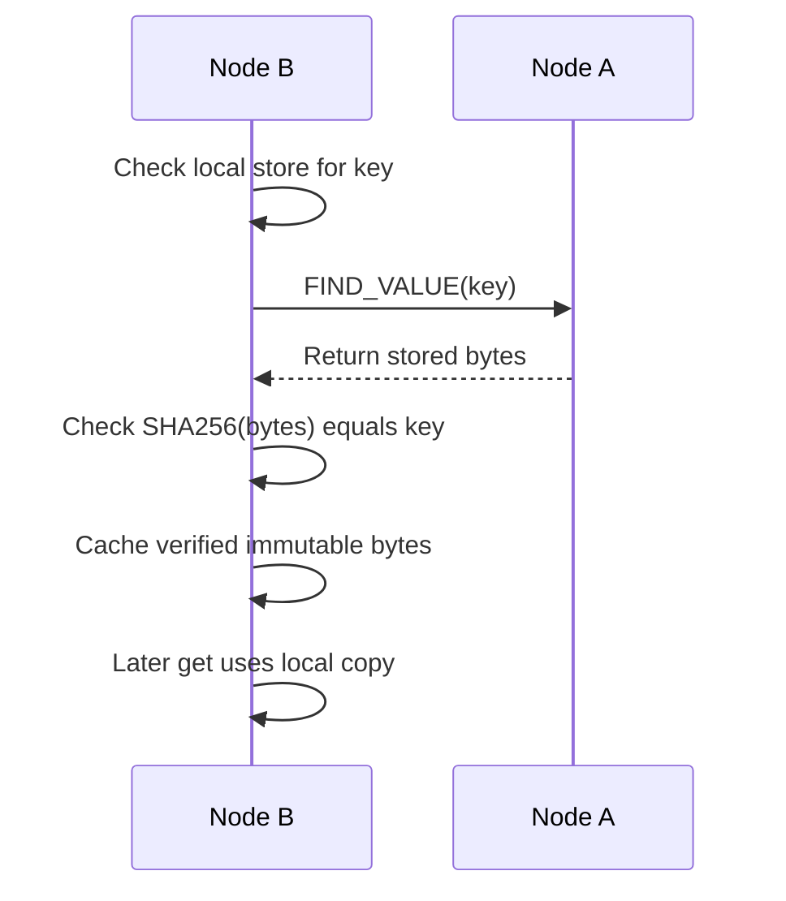
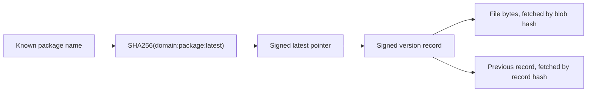

# D7024E: learn and demonstrate Parts 1 and 2

Read this guide in order. At each stage, run the commands, inspect the result, and answer the check before moving on. You do not need to understand every source file first.

**The system in one sentence:** we built a package registry whose files are distributed across nodes; hashes identify the bytes, signatures identify the authorized publisher, and linked records preserve release history.

This guide includes both parts. The lecturer's latest announcement focuses on the Part 2 sequence. Its correction is incorporated: **publish version 5 successfully, then reject attempted versions 3 and 4 as rollbacks**. Live missing-history catch-up is not required for that presentation, but you must explain it.

## Contents

1. [What we built and what must be delivered](#1-what-we-built-and-what-must-be-delivered)
2. [Prepare one fresh practice directory](#2-prepare-one-fresh-practice-directory)
3. [Part 1: start a node and store a file](#3-part-1-start-a-node-and-store-a-file)
4. [Part 1: join, ping, and understand routing](#4-part-1-join-ping-and-understand-routing)
5. [Part 1: retrieve, verify, and cache](#5-part-1-retrieve-verify-and-cache)
6. [Part 1: store replicas across three nodes](#6-part-1-store-replicas-across-three-nodes)
7. [Part 1: demonstrate periodic replication and churn](#7-part-1-demonstrate-periodic-replication-and-churn)
8. [Part 2: ownership, keys, and the three objects](#8-part-2-ownership-keys-and-the-three-objects)
9. [Part 2: publish version 1 and install latest](#9-part-2-publish-version-1-and-install-latest)
10. [Part 2: publish version 2 and retrieve an older version](#10-part-2-publish-version-2-and-retrieve-an-older-version)
11. [Part 2: reject publication by another owner](#11-part-2-reject-publication-by-another-owner)
12. [Part 2: reject replacement of an existing version](#12-part-2-reject-replacement-of-an-existing-version)
13. [Part 2: accept version 5, then reject versions 3 and 4](#13-part-2-accept-version-5-then-reject-versions-3-and-4)
14. [Part 2: explain forks, catch-up, caching, and timeouts](#14-part-2-explain-forks-catch-up-caching-and-timeouts)
15. [Implementation details, tests, and code map](#15-implementation-details-tests-and-code-map)
16. [Demonstrate the container network](#16-demonstrate-the-container-network)
17. [Explain the experiments](#17-explain-the-experiments)
18. [Presentation checklist and troubleshooting](#18-presentation-checklist-and-troubleshooting)
19. [Answers to the understanding checks](#19-answers-to-the-understanding-checks)

## 1. What we built and what must be delivered

| Part | Question it answers | Main implementation |
| --- | --- | --- |
| Part 1: distributed key-value storage | Where can I get the bytes identified by this hash? | Kademlia routing, UDP RPCs, lookup, storage, verification, and replication |
| Part 2: package registry | Which bytes belong to this package/version, and did its owner authorize them? | Domain ownership, signatures, version records, latest pointers, and history validation |

A **node** is one running instance of our Go program. It can publish, install, route requests, and store replicas. These roles do not require different programs.

The complete deliverables are: the implementation of both parts; automated tests including 1000-node simulations, race checks, and at least 80% coverage; a network of at least 50 node containers; the two required experiments; a written report; and the ability of every member to demonstrate and explain the system.

The repository now includes the finalized [report](../REPORT.md), including registry design and evaluation. Check Canvas separately for signup and report submission. Neither the local specification nor the supplied announcement explicitly requires slides. The announcement specifies the Part 2 demonstration; the broader lab requirements remain in [LAB-SPEC.md](LAB-SPEC.md).

## 2. Prepare one fresh practice directory

### Know which terminal you are using

| Terminal | Role | Commands typed there |
| --- | --- | --- |
| S | Ordinary shell for setup and reading files | `go`, `cat`, `cmp`, `docker`, shell variables |
| A | Owner/publisher node | `put`, `publish`, `show`, etc. at its `>` prompt |
| B | Reader node | `get`, `install`, `show`, etc. |
| C | Another reader | Old-version installation and independent checks |
| R and T | Two temporary nodes for the replication exercise only | Used in Section 7, then stopped |

**Copy command blocks only. Do not type the `>` prompt or output such as `published ...` back into the program.** `cat` is a shell command; it is not a node command.

This guide creates a new practice directory. It does not reuse or reset the earlier `kad-lesson`, `kad-review`, or `kad-sprint3` folders. Ports 8401–8405 are used; if one is occupied, change the matching port in the launcher and all corresponding addresses in the guide.

In S, start in this repository's `labs/` directory. On Jerald's Mac:

```sh
cd /Users/jeraldlim/Desktop/Lulea/Mobile_Distributed/d7024e/labs
```

Then run this entire setup block once. It builds the current source, creates tiny example files, and creates a launcher so each terminal only needs one start command.

<!-- demo-setup -->
```sh
lab_dir="$PWD"
demo_dir=$(mktemp -d /tmp/kad-complete.XXXXXX)
printf 'release one\n' > "$demo_dir/file1.txt"
printf 'release two\n' > "$demo_dir/file2.txt"
printf 'different replacement content\n' > "$demo_dir/file3.txt"
printf 'release five\n' > "$demo_dir/file5.txt"
go build -o "$demo_dir/node" .
for name in a b c r t; do
  mkdir "$demo_dir/$name"
  cp "$demo_dir"/file*.txt "$demo_dir/$name/"
done
cat > "$demo_dir/start-node.sh" <<'SH'
#!/bin/sh
set -eu
demo_root=$(CDPATH= cd "$(dirname "$0")" && pwd)
demo_label=${1:-}
replication=1h
case "$demo_label" in
  a) node_port=8401 ;;
  b) node_port=8402 ;;
  c) node_port=8403 ;;
  r) node_port=8404; replication=3s ;;
  t) node_port=8405; replication=3s ;;
  *) echo 'Usage: start-node.sh a|b|c|r|t' >&2; exit 1 ;;
esac
cd "$demo_root/$demo_label"
export BIND_IP=127.0.0.1 PORT="$node_port" BOOTSTRAP='' HEADLESS=0
export ALPHA=3 RPC_TIMEOUT=2s REPLICATION_INTERVAL="$replication" REFRESH_INTERVAL=1h
export OWNERS_FILE="$demo_root/owners.json" KEYS_DIR="$PWD/keys"
exec ../node 2>node.log
SH
chmod +x "$demo_dir/start-node.sh"
printf 'Practice folder: %s\n' "$demo_dir"
for name in a b c r t; do
  printf 'Terminal %s launch command: %s/start-node.sh %s\n' "$name" "$demo_dir" "$name"
done
```

Keep S open. `$demo_dir` is a shell variable available in S; other terminal tabs do not automatically inherit it. The printed launch commands contain the actual directory and can be copied into the appropriate tabs when instructed below. They look like `/tmp/kad-complete.…/start-node.sh a`.

**Do not start all nodes yet. Start A in the next section; B and C join later.** This order lets us demonstrate a remote download before replicas are already present everywhere.

The launcher gives each node its own working directory and private-key directory. The ownership file is shared. Logs go to each node's `node.log` so the interactive output stays readable. A/B/C use a one-hour replication interval to keep background copying from obscuring the early download exercise. R/T use three seconds for the separate maintenance exercise.

The files are small text stand-ins for package binaries. A filename does not determine the package version; `file3.txt` will be used as attempted replacement content, not initially as version 3.

## 3. Part 1: start a node and store a file

Start A using the launch command printed for A. At A's node prompt:

```text
show rt
show ds
put file1.txt
show ds
```

### Expected observations

- Startup prints A's node ID and `127.0.0.1:8401`.
- Initially the routing table reports no contacts and the data store is empty.
- `put` prints `stored as` followed by a 64-character key.
- The final data-store listing shows the key and a 12-byte value.

For the exact `file1.txt` created above, including its newline, the full key is:

```text
341210484fa4e3015d3123407ad94a84c1eb778102160cf76d2cf0c70e135571
```

In S, independently hash the original file:

```sh
shasum -a 256 "$demo_dir/file1.txt"
```

The hash should match the key printed by `put`. The shortened key in `show ds`, such as `34121048…5571`, is only for display. A `get` needs the full key.

### Concept and implementation

There are two different hashes here. A's **node ID** is `SHA256("127.0.0.1:8401")`. The **file key** is `SHA256(file bytes)`. They occupy the same 256-bit ID space but identify different things.

`Store` computes the file key, finds up to k closest nodes, and sends each the same `(key, bytes)` pair. Each accepted full copy is one replica. k defaults to 10, but A knows no other nodes yet, so there is only one copy in the distributed store. The source file on your disk is separate from that in-memory store.

Content addressing makes immutable data self-verifying: a receiver can recompute the bytes' hash. It does not establish who published the bytes. Nobody needs a signing key for an ordinary `put`.

**Say during the demo:** “The file is stored under its SHA-256 hash. Anyone retrieving that key can check whether the received bytes match it.”

**Code:** [Store and StoreAt](kademlia/kademlia.go), [value acceptance](kademlia/value.go), [CLI](main.go).

**Check P1:** Why do we have one stored copy even though k is 10? Would changing one character in the file normally preserve its key?

## 4. Part 1: join, ping, and understand routing

Start B with its printed launch command. At B's prompt:

```text
show rt
show ds
join 127.0.0.1:8401
ping 127.0.0.1:8401
show rt
show ds
```

### Expected observations

B initially knows no contacts. After joining, its routing table contains A, and PING reports a reply and round-trip time. B's data store remains empty at this stage. Joining does not download A's stored values.

A is B's **bootstrap node**: the first existing participant B contacts. It is not a central database. Once peers discover each other, they can communicate directly.

The implemented join procedure contacts the bootstrap, looks up the joining node's own ID to discover its neighborhood, then refreshes farther bucket ranges. Those lookups can reveal more contacts. A standalone `ping` can learn a responsive contact, but it does not perform that full procedure.

### How XOR and discovery fit together

XOR ranks IDs; it does not derive an IP address. Addresses come from bootstrap configuration and contacts returned by peers. For a tiny four-bit example:

| Target | Node ID | XOR distance | Order |
| --- | --- | --- | --- |
| `1010` | `1011` | `0001` = 1 | Closest |
| `1010` | `1000` | `0010` = 2 | Next |
| `1010` | `0010` | `1000` = 8 | Farthest |

The real implementation does this over 256 bits. Smaller numerical XOR distance means closer in the ID space, regardless of geography.

For a lookup, the requesting node asks known contacts, incorporates their referrals, then asks closer unqueried candidates. It controls the iteration. Each peer does not recursively perform the ordinary lookup on its behalf. The node sends up to alpha requests per round; alpha defaults to 3. Our implementation waits for that batch before processing another one.

Knowing an address allows an attempt to contact it; it does not guarantee a reply. The program may have stopped, or packets may fail to arrive. Our `ping` is an application-level UDP RPC, not the operating system's ICMP `ping` command.

**Say:** “The routing table is my contact book. The data store is the set of values this node actually holds.”

**Code:** [Join](kademlia/maintenance.go), [routing table](kademlia/routingtable.go), [XOR](kademlia/kademliaid.go), [parallel lookup](kademlia/lookup.go).

**Check P2:** B knows A but has no data. What does B's routing-table entry contain? Does XOR tell B A's address?

## 5. Part 1: retrieve, verify, and cache

At B's prompt:

```text
get 341210484fa4e3015d3123407ad94a84c1eb778102160cf76d2cf0c70e135571
get 341210484fa4e3015d3123407ad94a84c1eb778102160cf76d2cf0c70e135571 downloaded.txt
show ds
```

### Expected observations

The first lookup should print `release one` and `(found on 127.0.0.1:8401)`. The second reports a local result and writes 12 bytes to B's `downloaded.txt`. B's store now contains the value. If the one-hour replication timer has already copied the value, the first result can also be local; use a fresh rehearsal to reproduce the remote-first sequence.

In S:

```sh
cat "$demo_dir/b/downloaded.txt"
cmp "$demo_dir/file1.txt" "$demo_dir/b/downloaded.txt"
```

`cat` prints `release one`. `cmp` succeeds silently when the files match.

### What happened internally



In a larger network, a peer without the value can return contacts closer to the key; the requester follows those referrals. This small exercise demonstrates retrieval and caching. It does not by itself prove multi-round routing or alpha parallelism; the tests and experiments exercise those.

If A stops now, B can still read its cached value while B remains running. A read-created copy is different from the periodic replication process demonstrated below. A file existing in B's working directory also does not automatically mean it exists in B's DHT store: `put`, accepted STORE messages, or successful immutable lookups populate that store.

**Code:** [LookupData](kademlia/kademlia.go), [lookup rounds](kademlia/lookup.go), [UDP handlers](kademlia/network.go).

**Check P3:** Why did the second retrieval avoid the network? Does the correct file hash prove that the owner of `example.com` authorized it?

Keep A and B running.

## 6. Part 1: store replicas across three nodes

Start C using its printed launch command. At C's prompt:

```text
join 127.0.0.1:8401
show rt
show ds
```

Then at A:

```text
put file2.txt
```

At B and C, run:

```text
show ds
```

Both should contain the new file's key, starting `3ef6b3f2` and ending `d49f`. Neither needed to call `get` for this file. A's STORE operations created those replicas.

### Concept and implementation

The target is **the file's hash**. Lookup discovers candidates, then `StoreAt` selects up to k unique closest contacts, including the publisher if appropriate. Every selected node receives one complete copy. k = 10 means a target of ten replica nodes, not ten copies on each node. With three reachable nodes, we can have three replicas. Failures may leave fewer; later immutable read caches can create more than k total copies.

With more than k nodes, the publisher itself need not be selected. The four network operations are:

| RPC | What the receiver does |
| --- | --- |
| PING | Responds to show reachability |
| FIND_NODE | Returns known contacts close to the target ID |
| FIND_VALUE | Returns the value if held, otherwise nearby contacts |
| STORE | Validates and stores the supplied key/value |

**Say:** “k controls the desired replica count and bucket capacity; alpha controls concurrent lookup probes.”

**Code:** [StoreAt](kademlia/kademlia.go), [RPC transport](kademlia/network.go).

**Check P4:** If k is 10 and alpha is 3, does that mean only three nodes can store the file?

## 7. Part 1: demonstrate periodic replication and churn

This is a separate, short exercise. Keep A/B/C running for Part 2. Open two extra tabs for R and T, using their printed launch commands when instructed. They use ports 8404/8405 and a three-second replication interval.

Start **R only**. At R:

```text
put file1.txt
```

Now start T. At T:

```text
join 127.0.0.1:8404
show ds
```

Wait a few seconds and repeat `show ds` until key `34121048…5571` appears. **Do not run `get` before that:** a get could download/cache it and would not demonstrate the maintenance worker.

At R:

```text
exit
```

At T:

```text
get 341210484fa4e3015d3123407ad94a84c1eb778102160cf76d2cf0c70e135571
exit
```

The get should return `release one` locally after R has stopped. R and T have now finished; A/B/C remain available for Part 2.

### Concept and implementation

**Churn** is nodes joining and leaving. R stored the file before it knew T. Its periodic worker later looked up the current closest nodes and sent STORE requests, including T. T retained its copy after R left.

Each node republishes its locally held values periodically. Values have **no expiration/TTL**, as the lab requires. This is different from **bucket refresh**, which searches idle ID ranges to maintain contacts. Replication maintains copies of data; refresh maintains routing knowledge.

There is no disk persistence for the node's DHT store. Replication helps only while some copy survives long enough to be replicated. Losing every copy loses the data. The downloaded output file on disk is separate from that in-memory state.

**Code:** [Republish and maintenance workers](kademlia/maintenance.go).

**Check P5:** Why did we wait for `show ds` without calling `get`? Why would restarting all nodes fail to recover their previous in-memory stores automatically?

## 8. Part 2: ownership, keys, and the three objects

Continue using the still-running A, B and C. Our package name is `example.com:tool`. Here `example.com` is an ownership namespace; this demonstration does not download files from that website.

At A:

```text
keygen example.com
show dns example.com
```

At B:

```text
show dns example.com
```

### Expected observations

A prints the path of its private key and the registered public key/fingerprint. B displays the same public ownership information. B does not acquire A's private key.

| Term | Meaning in this implementation |
| --- | --- |
| Private key | Secret signing material, generated using secure randomness and saved in A's own keys directory |
| Public key | Corresponding verification key, safe to share |
| Fingerprint | Short display identifier derived from the public key |
| Fake DNS | Shared `owners.json`, mapping domain names to public keys |
| Signature | Evidence that the corresponding private key authorized particular metadata |
| File hash | Identifier that lets a reader check whether file bytes match the expected contents |

The public key does not locate files, decrypt them, or grant download access. The ownership mapping supplies the trusted key used for signature verification. The lab permits this fake DNS; the CLI uses it in our demo. The registry also has a DNS TXT ownership provider behind an interface, but these launchers use the shared file.

### Understand the three stored objects

| Object | Key | What the value contains |
| --- | --- | --- |
| Package blob | `SHA256(file bytes)` | The downloadable file bytes |
| Version record | `SHA256(encoded signed record)` | Tag, domain, package, version, blob hash, previous-record hash, signature |
| Latest pointer | `SHA256("domain:package:latest")` | Tag, domain, package, version, version-record hash, signature |

The blob and version record are immutable. The pointer's value changes under a stable name-derived key so a reader knowing the package name can find its current starting point.



In this implementation, Ed25519 signs the SHA-256 digest of canonical unsigned JSON metadata. The record hash used as its storage address is calculated from the encoded **signed** record. These are different uses of hashing.

Two checks work together:

1. Verify the record/pointer signature with the trusted owner's public key. This checks authorization of its fields, including the blob hash.
2. Hash the downloaded file bytes and compare with the blob hash from the verified record. This checks that the downloaded bytes are the authorized content.

The public key is not included as an extra input to the file hash. No signature is generated merely by knowing that public key.

**Code:** [key generation](registry/keys.go), [owners](registry/owners.go), [records and signatures](registry/records.go), [CLI wiring](registry_cli.go).

**Check P6:** What does the public key verify? What does hashing the file verify? Why does B's knowledge of the public key not let it sign releases as A?

## 9. Part 2: publish version 1 and install latest

At A:

```text
publish example.com:tool:1.0.0 file1.txt
```

At B:

```text
install example.com:tool:latest latest.txt
show example.com:tool
show ds
```

In S:

```sh
cat "$demo_dir/b/latest.txt"
cmp "$demo_dir/file1.txt" "$demo_dir/b/latest.txt"
```

### Expected observations

Publication succeeds. B reports installation of version 1.0.0. The saved file contains `release one`, and `cmp` succeeds. The package history contains one release. `show ds` includes a `version-record` and a `latest-pointer`, alongside ordinary blob entries. It can also contain the Part 1 files; do not expect the store to contain exactly three entries.

### Trace the operation

Publishing: read current pointer → choose predecessor → hash file → sign record and pointer → upload blob → upload record → update pointer. The records are uploaded before the pointer so receiving replicas can fetch the proposed history when validating it.

Installing: derive the stable pointer key → obtain and verify pointer → obtain and verify the referenced record/history as needed → fetch blob by hash → check blob hash → save file. `latest.txt` is a local output filename, not the DHT pointer itself.

Our Part 2 integration adds `SetValueValidator` and `StoreAt` to the core. Ordinary values must match their content hash. A non-content-addressed pointer must instead pass the registered registry validator. Invalid pointer updates leave the accepted pointer unchanged. Every destination performs its own checks.

**Say:** “The file hash tells me which bytes to fetch; the signed record binds those bytes to this owner, package and version.”

**Code:** [Publish and Install](registry/client.go), [DHT adapter](registry/dht/backend.go), [validator adapter](registry/dht/validator.go), [core value acceptance](kademlia/value.go).

**Check P7:** Why does publication upload the record before moving the pointer? Why is the pointer's key based on the name rather than its changing bytes?

## 10. Part 2: publish version 2 and retrieve an older version

At A:

```text
publish example.com:tool:2.0.0 file2.txt
```

At B:

```text
install example.com:tool:latest latest.txt
show example.com:tool
```

At C:

```text
install example.com:tool:1.0.0 old.txt
```

In S:

```sh
cat "$demo_dir/b/latest.txt"
cmp "$demo_dir/file2.txt" "$demo_dir/b/latest.txt"
cat "$demo_dir/c/old.txt"
cmp "$demo_dir/file1.txt" "$demo_dir/c/old.txt"
```

### Expected observations

B installs 2.0.0 and gets `release two`. C explicitly installs 1.0.0 and gets `release one`. The chain is `2.0.0 -> 1.0.0`, newest first.

The latest pointer's key stayed the same. Its accepted value now references the new record. The old record and blob still have their original hashes, and the new record links to the old record. Installing an older version follows those links from the current head.

This resembles Git's immutable objects and movable references. Our registry enforces a single accepted history at each replica; it does not provide Git's general branch/merge workflow.

**Code:** [previousRecord, Chain, and Install](registry/client.go), [history traversal](registry/validate.go).

**Check P8:** Which object changed under its existing key? Why did that not destroy version 1?

## 11. Part 2: reject publication by another owner

The announcement asks for a node trying to publish under a domain whose secret key it does not possess. A owns `example.com`; B has no private key for it.

At B:

```text
publish example.com:intrusion:1.0.0 file3.txt
```

At C:

```text
show example.com:intrusion
install example.com:intrusion:latest blocked.txt
```

### Expected observations

B reports no private key for `example.com`. C cannot find the attempted package, and installation fails. This uses a different package name, `intrusion`, so it is easy to demonstrate that it was never successfully published.

This particular attempt stops in the CLI before any upload. That is different from receiving and rejecting an actual signature from the wrong key. Both protections exist; the optional exercise below shows receiver enforcement too.

Do not try to solve the deliberate failure by registering A's domain again on B. Sharing the owner's private key would defeat the setup we want to demonstrate.

### Optional: send an actual wrong-key signature to receivers

At B:

```text
keygen intruder.example
```

In S, copy this unrelated demonstration key within B's disposable practice directory, using the filename its CLI expects:

```sh
cp -n "$demo_dir/b/keys/intruder.example" "$demo_dir/b/keys/example.com"
```

At B:

```text
publish --force example.com:intrusion:1.0.0 file3.txt
```

At C:

```text
show dns example.com
show example.com:intrusion
```

The owner mapping remains A's public key. Receivers reject the wrong signature, and the package is still absent. The copy only supplies B with an unrelated signing key; it does not make that key the trusted owner. This changes only disposable demo credentials and does not affect A's key or later publications from A.

**Code:** [CLI private-key loading](registry_cli.go), [owner and signature checks](registry/validate.go).

**Check P9:** What is the difference between the first missing-key failure and the optional wrong-signature failure?

## 12. Part 2: reject replacement of an existing version

At A, attempt to replace the accepted version 2.0.0 using different bytes:

```text
publish --force example.com:tool:2.0.0 file3.txt
```

At B:

```text
install example.com:tool:latest latest.txt
show example.com:tool
```

In S:

```sh
cat "$demo_dir/b/latest.txt"
cmp "$demo_dir/file2.txt" "$demo_dir/b/latest.txt"
```

### Expected observations

The attempted publication fails with a fork/history error. B still installs 2.0.0 with the original `release two` content. The attempted replacement does not become the accepted release.

Each replica's stored pointer identifies its accepted record by hash. The incoming pointer claims the same version but a different record hash, so it conflicts with the accepted history. Even the legitimate owner is not allowed to redefine that version.

`--force` bypasses the publisher's precheck; it does **not** disable receiving-node validation. Without it, an invalid publication can stop locally before any receiver assesses it.

An identical accepted pointer can be resent harmlessly by transport retries or replication. Running a new `publish` is not necessarily identical: it can construct a new predecessor link and therefore a different record.

**Code:** the equal-version branch of [Validator.Validate](registry/validate.go).

**Check P10:** Why does a correct owner signature fail to make this replacement acceptable? What exactly does the replica compare?

## 13. Part 2: accept version 5, then reject versions 3 and 4

This is the lecturer's **corrected** final scenario. Versions need a total order and must advance; they need not be consecutive. Use three numeric components in this CLI.

At A:

```text
publish example.com:tool:5.0.0 file5.txt
```

At B:

```text
install example.com:tool:latest latest.txt
```

This must succeed and report 5.0.0. Now, at A:

```text
publish --force example.com:tool:3.0.0 file3.txt
publish --force example.com:tool:4.0.0 file3.txt
```

At B:

```text
install example.com:tool:latest latest.txt
show example.com:tool
```

In S:

```sh
cat "$demo_dir/b/latest.txt"
cmp "$demo_dir/file5.txt" "$demo_dir/b/latest.txt"
```

### Expected observations

Both lower-version attempts fail with rollback errors. Latest remains 5.0.0, the file contains `release five`, and the accepted chain contains exactly three versions:

```text
5.0.0 -> 2.0.0 -> 1.0.0
```

The value 5 is greater than 2, and the version-5 record links to the exact accepted version-2 record. Therefore it extends history correctly. Afterwards, 3 and 4 are smaller than the accepted 5, so the validator rejects them.

Forced attempts may upload immutable blobs/records before the pointer fails. Extra entries in `show ds` therefore do not mean a release was accepted. Show the package chain, installed version, and downloaded bytes. The error message's conditional statement about replicas keeping accepted writes does not mean any replica accepted these rejected updates.

**Code:** [Version.Compare](registry/version.go), the lower-version branch of [Validator.Validate](registry/validate.go).

**Check P11:** Why is `2 -> 5` valid but attempting 3 after 5 invalid? Do the filenames `file3.txt` and `file5.txt` control this decision?

## 14. Part 2: explain forks, catch-up, caching, and timeouts

### Forks are detected using exact record hashes

A higher version can still be a fork. With accepted history `5 -> 2 -> 1`, a proposed `6 -> 2 -> 1` skips the accepted version-5 record.

Optional additional demonstration at A, after Section 13:

```text
publish --force --prev=2.0.0 example.com:tool:6.0.0 file3.txt
```

At B:

```text
show example.com:tool
```

The fork should be rejected and latest remain 5.0.0. The validator follows previous-record hashes until it reaches its exact accepted head, or establishes that the proposed chain does not extend it. Matching only version labels would not be enough: two different records can claim the same number.

Signatures include the previous-record hash, so changing that link invalidates the original signature. An owner can sign a different link, but receivers still enforce the history rule. A fresh replica with no accepted pointer checks the complete supplied chain but cannot detect a competing history it never saw. This is not global consensus.

### Catch-up follows record links, not missing numbers

The announcement says you do not need to arrange this live. Explain a **separate hypothetical** valid chain:

```text
5 -> 4 -> 3 -> 2 -> 1
```

A replica knows version 2 but missed publications 3 and 4. When it receives the pointer for 5:

1. Verify the pointer's identity and owner signature.
2. Fetch record 5 by its hash.
3. Follow its predecessor link to record 4, then record 3.
4. Verify fetched hashes, signatures, matching domain/package, and version ordering.
5. Reach the exact version-2 record it already accepted.
6. Accept the pointer for 5. If required history is missing or invalid, keep the old pointer.

In our actual demo `5 -> 2 -> 1`, records 3 and 4 do not exist in the accepted history. A receiver does not invent or request them just because the version numbers have gaps. The links tell it what to fetch. The core callback uses `LookupData` for missing immutable records. A default 1000-record traversal limit bounds validation work.

### Why the mutable-pointer cache needed fixing

With more than k nodes, a reader outside the replicas used to cache an old pointer. A later publication updated the k replica nodes, but that reader kept answering from its stale copy.

Now mutable reads are validated but do not create extra stored pointer copies. Explicit STORE requests establish mutable replicas. The registry also avoids forcing a pointer copy onto a non-replica publisher. Immutable records and blobs remain safe to cache.

Our three-node exercise does not reproduce the original bug: with k=10, all three nodes can be replicas. Larger regression tests deliberately select non-replica readers. Actual replicas that miss an update can still serve an older accepted pointer; the fix does not guarantee globally freshest reads. Non-replica readers also retain no mutable history checkpoint across reads.

### A timeout is an uncertain outcome

Each replica validates independently. Validation may fetch history before the STORE acknowledgement is sent. The publisher can time out while the receiver is still working; the receiver may later commit. Other replicas may already have accepted the update. The publication is not an atomic transaction across all nodes, and a failure does not undo accepted writes.

The default timeout is 500 ms per attempt with two retries. We use 2 s for this rehearsal. Kim's rebuilt 50-container run reported two timeouts in eight publications at 500 ms and none in eight at 2 s; the timed-out publications were later visible. This is a small observed sample, not a guarantee or proof of the cause of every delay. Inspect the resulting history before deciding what to do after a real timeout.

**Code:** [registry validator](registry/validate.go), [core acceptance and concurrent recheck](kademlia/value.go), [UDP transport](kademlia/network.go), [DHT adapter](registry/dht/backend.go).

**Check P12:** How does a missed update differ from a fork? Does a valid signature prove a pointer is the newest one? Can a timed-out publication still become visible?

## 15. Implementation details, tests, and code map

### Features you should explain even when not visible in a small demo

| Feature | Implemented behavior / reason |
| --- | --- |
| Routing buckets | 256 fixed buckets, the permitted b=1 simplification. Default capacity k=10. Bucket 0 is the farthest range in this implementation. |
| Full bucket | PING least recently seen contact; keep responsive contact, replace a failed one when safe. Concurrent activity protects a refreshed contact from an old timeout. |
| Joining and refresh | Bootstrap contact, self-lookup, join-time farther-range refresh; a periodic worker also refreshes idle ranges. |
| Lookup termination | Iterative coordinator queries closest remaining candidates; value lookup may finish after a successful batch. Failed peers are excluded. |
| UDP RPC reliability | JSON requests/responses, unpredictable 128-bit request IDs, response matching, configurable deadlines, and two retries by default. No external RPC library. |
| Network abstraction | `RPCClient` permits real UDP and a simulated transport using the same core algorithms. |
| Value integrity and size | Hash verification on ordinary stores and lookups; explicit 4096-byte maximum; rejected values are not accepted into the store. |
| Maintenance | Periodic replication without expiration; separately, idle routing-bucket refresh. |
| Parameters | `ALPHA`, `REPLICATION_INTERVAL`, `REFRESH_INTERVAL`, `RPC_TIMEOUT`; k adjustable in `NewRoutingTable(me, k)`. Recompilation for k is permitted. |
| Structured instrumentation | JSON lookup probes/outcomes, rounds, success, errors, elapsed time, and local hits. Transport retries are not extra logical probes. |
| Registry representation | Canonical JSON, SHA-256, Ed25519, base64 public keys, numeric versions with no leading zeros, and signed type/domain/package/version bindings. |
| Registry rules | Owner-only pointer updates, no replacement of an accepted version, no rollback, no fork relative to accepted history, and missing-history catch-up. |
| Mutable integration | `SetValueValidator`, `StoreAt`, validated reads, preservation of rejected current values, and replication under the pointer's original key. |

### Thread safety in plain language

Several goroutines can operate on one node at once: CLI work, incoming UDP handlers, lookup probes, replication, and refresh. A mutex protects shared state while it is inspected or changed.

- Each bucket protects its contacts and maintenance state with a lock.
- The local value map uses an RWMutex: multiple readers can coexist; changes require exclusive access.
- Stored/returned bytes are copied so callers cannot mutate stored values through an aliased slice.
- Lookup candidates belong to one coordinator; concurrent RPC workers return results through channels.
- A validator runs outside the data lock because it may fetch/cache records through the same store. Holding that lock could block work needed by the fetch.
- Before committing a validated pointer, the core rechecks whether another write changed its current-value snapshot. If so, it validates again. This prevents two competing updates from silently validating against the same obsolete head.

### Tests to show

In S, return to the project directory:

```sh
cd "$lab_dir"
```

Run the two large scenarios without `-short`:

```sh
go test -count=1 -v ./experiment ./registry/dht -run '^TestThousandNode(Network|Registry)$'
```

For full verification before the review:

```sh
go test -race -coverpkg=./... -coverprofile=/tmp/kademlia-demo-coverage.out ./...
go tool cover -func=/tmp/kademlia-demo-coverage.out
go vet ./...
```

Read the combined `total:` coverage line. The latest recorded full run passed at **93.3%**, above the required 80%, including both 1000-node tests. Coverage measures exercised statements; a clean race run checks executed paths. Neither proves every possible failure or interleaving is covered.

Useful focused tests when asked for evidence:

```sh
go test -count=1 -v ./kademlia -run 'Test(FullBucketPingsLeastRecentlySeen|JoinLooksUpSelfThenRefreshesFartherBuckets|LookupParallelismAndProbeLogs|StoreValueRejectsMismatchedKey|LookupDataRejectsHashMismatch|ValueSizeLimitAtAllStoreEntryPoints)$'
go test -count=1 -v ./registry/dht -run 'Test(WrongOwnerIsRejected|RollbackAndForkAreRefusedByReplicas|MissingHistoryCatchUp|BehindNodeThatCannotFetchHistoryKeepsItsPointer|NonReplicaReadsLatestAfterPublication)$'
```

`put` generates a correct hash itself, so an ordinary CLI put is not evidence of rejecting a deliberately incorrect hash. The tests inject those invalid cases. `-count=1` requests actual execution rather than reuse of cached test results.

### Open these files when tracing a command

| What to trace | Files |
| --- | --- |
| Startup, commands, environment settings | [main.go](main.go), [registry_cli.go](registry_cli.go) |
| Find/store data and choose replicas | [kademlia.go](kademlia/kademlia.go), [lookup.go](kademlia/lookup.go) |
| Join, replication, refresh | [maintenance.go](kademlia/maintenance.go) |
| Routing and bucket eviction | [routingtable.go](kademlia/routingtable.go), [bucket.go](kademlia/bucket.go) |
| UDP and simulated transport | [network.go](kademlia/network.go), [simnetwork.go](kademlia/simnetwork.go) |
| Publish/install, signed objects, history rules | [client.go](registry/client.go), [records.go](registry/records.go), [validate.go](registry/validate.go) |
| Registry-to-core integration | [backend.go](registry/dht/backend.go), [validator.go](registry/dht/validator.go), [value.go](kademlia/value.go) |
| Experiments and analysis | [runner](cmd/experiments/main.go), [measurement code](experiment/experiment.go), [analysis script](scripts/analyze.py) |

**Check P13:** Why run validation outside the data lock, and why recheck the current pointer afterwards? Why is k different from alpha?

## 16. Demonstrate the container network

The small local exercises teach the behavior. Separately, the lab requires at least 50 nodes in separate containers. Simulated 1000-node tests do not replace that demonstration. Kim's rebuilt 50-container run is documented in the report; rehearse on the machine used for the presentation.

Start Docker Desktop. In S, from `labs/`:

```sh
cd "$lab_dir"
git rev-parse HEAD
docker build -t kadlab:latest .
docker info --format '{{.Swarm.LocalNodeState}}'
```

If the reported Swarm state is `inactive`, initialize it once:

```sh
docker swarm init
```

For a new deployment:

```sh
RPC_TIMEOUT=2s docker stack deploy --resolve-image never -c docker-compose.yml kademlia
docker service scale kademlia_kademliaNodes=49
docker service ls
```

Wait until the actual running counts are **bootstrap 1/1 and workers 49/49**, giving 50 nodes. A desired count of 49 with fewer running workers is not enough. Start the whole network before publishing.

Record the image's source commit. Rebuilding an image alone does not replace already-running containers. For an existing stack, coordinate recreating the demo services; they lose their in-memory data on recreation. A shared owners volume can outlive containers, so use the matching existing private key or a fresh demo domain if the name is already registered.

### Interactive nodes for the presentation

The 50 service nodes run headlessly. Add interactive nodes on their attachable network. Each extra container increases the total above 50. In S:

```sh
mkdir -p "$demo_dir/docker-keys-a" "$demo_dir/docker-keys-b" "$demo_dir/docker-downloads-b"
```

In a new ordinary shell tab, assign `demo_dir` to the actual practice path printed in Section 2, then run this publisher container:

```sh
docker run --rm -it --network kademlia_kademlia_network \
  -e BOOTSTRAP=bootstrap:8000 -e RPC_TIMEOUT=2s \
  -e OWNERS_FILE=/shared/owners.json -e KEYS_DIR=/keys \
  -v kademlia_registry_shared:/shared \
  -v "$demo_dir/docker-keys-a:/keys" \
  -v "$demo_dir:/files:ro" kadlab:latest
```

In another shell tab, set the same `demo_dir` value, then run a reader:

```sh
docker run --rm -it --network kademlia_kademlia_network \
  -e BOOTSTRAP=bootstrap:8000 -e RPC_TIMEOUT=2s \
  -e OWNERS_FILE=/shared/owners.json -e KEYS_DIR=/keys \
  -v kademlia_registry_shared:/shared \
  -v "$demo_dir/docker-keys-b:/keys" \
  -v "$demo_dir/docker-downloads-b:/downloads" \
  -v "$demo_dir:/files:ro" kadlab:latest
```

Run the Part 2 sequence in these container prompts using `/files/file1.txt`, `/files/file2.txt`, etc. as input paths. On the reader, install to `/downloads/latest.txt`; S can inspect it at `$demo_dir/docker-downloads-b/latest.txt`. A third interactive reader can be started with its own keys/downloads directories to perform the old-version check on another node.

The local practice network's owners file is separate from the Docker shared volume. Register your demo domain on the container publisher too if it is not already registered there. Keep each publisher's private keys separate; all containers use the common owners volume. Do not start a second node executable inside an already-running node container on the same port.

To specifically demonstrate the cache fix, choose a reader with **no stored latest pointer** for the package after its first install. It can have immutable records/blobs. Publish the next release, then install latest again on that reader. If it holds a pointer because it is a STORE replica, choose another reader for this particular regression scenario.

After the container rehearsal, exit interactive nodes. To remove this project's services when you are finished with them:

```sh
docker stack rm kademlia
```

This stops the demo network; do it after the demonstration, not midway through publication tests.

**Check P14:** Why test both 1000 simulated nodes and 50 real containers? Why do nodes share the owners file but not the owner's private key?

## 17. Explain the experiments

The two required experiments and their full results already exist. Open the plots and describe their axes before interpreting them:


| Experiment | Setup / expectation | Recorded observation |
| --- | --- | --- |
| Scalability | N from 16 to 2048, ten seeds per size, k=10, alpha=3, no loss; expect roughly logarithmic growth in lookup work | Mean node probes rise from 10.0 to 14.2; value probes from 3.0 to 6.6. All 8000 measured lookups succeeded. |
| Packet-loss reliability | 500 nodes, ten seeds per configuration, independent loss per request/response leg, compare alpha 1/3 and zero/two retries | At 50% loss, alpha 3 with two retries gives 99.7% ± 0.5 percentage points success versus 83.7% ± 3.7 without retries. |

The reported variation is standard deviation across seeds. These results describe the measured setups, not a universal guarantee.

Know the measurement terms:

- **Probe:** one logical query sent to a peer during a lookup.
- **Retry:** another transport attempt for that RPC; it is not another logical probe in these logs.
- **Round:** a batch of up to alpha parallel probes.
- **Seed:** an explicit random-generator input used to construct experiment cases.
- **Success:** the lookup found acceptable data; node-lookup metrics also distinguish finding the true closest node.

Seeds and repeated configurations expose variation across random topologies and data. Concurrent scheduling can still influence a seeded run. The experiments establish the network under healthy conditions before loss measurements; the two plots do not measure churn. Tests cover churn separately. Read caching changes available copies over sequential queries. Simulated rounds are a latency proxy, not measured real-network milliseconds.

To show how logs become results without overwriting the committed full sweep, in S:

```sh
cd "$lab_dir"
experiment_dir=$(mktemp -d /tmp/kad-experiments.XXXXXX)
go run ./cmd/experiments -quick -seeds 2 -out "$experiment_dir"
python3 scripts/analyze.py "$experiment_dir"
```

The runner produces structured JSONL logs. The external Python script produces CSV tables, SVG plots, and a Markdown summary. This small run demonstrates the pipeline; the numerical claims above come from the committed full runs in [results/summary.md](experiments/results/summary.md) and the [report](../REPORT.md).

**Check P15:** Why use multiple seeds? Does increasing alpha necessarily reduce the number of probes? Why is a plot of rounds not a direct timing measurement?

## 18. Presentation checklist and troubleshooting

### Presentation order

| Segment | Show | Explain |
| --- | --- | --- |
| Opening | One sentence describing the system | Distributed storage underneath an authenticated package registry |
| Part 1 foundation | Routing table, PING, put/get, local store | Node IDs, keys, bootstrap, XOR, lookup and hash verification |
| Part 1 resilience | Copies appearing without reads, then original holder leaves | Initial STORE replication, periodic replication, caching and churn are distinct |
| Part 2 valid path | Publish 1, install latest, publish 2, install latest, install old 1 elsewhere | Blob, signed record, stable pointer, ownership and signatures |
| Ownership | Unauthorized attempt plus absence check | Missing-key CLI guard; receiver signature validation if doing the extra exercise |
| History safety | Replace version 2 with different content; latest remains unchanged | Same version/different record is refused |
| Corrected rollback test | Publish 5; reject 3 and 4; latest remains 5 | Total order permits gaps but forbids going backwards |
| Catch-up explanation | Draw a hypothetical linked chain | Fetch missing records by hash and validate back to accepted history |
| Supporting evidence | Tests, 50 containers, plots, report | Concurrency, scale, experimental methodology and limitations |

Use the lecturer's Part 2 sequence for the announced review. The Part 1 sections build your understanding and provide a demonstration if requested; this guide does not assign an official review duration.

### Limits to explain honestly

- The DHT store is memory-only; every copy disappearing loses the data.
- A value is at most 4096 bytes. Larger packages would need chunking or a separate transfer mechanism.
- Fake DNS is a trusted external ownership mapping. Arbitrary changes to it undermine that identity assumption.
- History validation is relative to the node's known accepted history; there is no global consensus or guaranteed freshest read.
- A valid old signature remains valid; authenticity alone is not freshness.
- Lookup failure can conflate absence and unreachability.
- Multi-replica publication can partially succeed, including after a timeout.

### Common output that can be confusing

| Output / problem | Meaning and response |
| --- | --- |
| `unknown command "first"`, `"published"`, or `"(found"` | Expected output was pasted as input. Continue with actual commands only. |
| `(found locally)` | The node already has a copy from STORE, replication, or a previous immutable read. Inspect the timing and prior actions before describing which mechanism created it. |
| `show ds` empty after join | Normal: contacts were discovered; no value has been stored/downloaded yet. |
| `keygen ... already has an owner` | The owner file is persistent. Reuse the matching private key, or use a fresh practice directory/domain for a full rerun. |
| `no private key` | That node cannot sign for the domain. This is expected in the first ownership rejection exercise. |
| `address already in use` | Another node is using the same port. Exit your old node or use a different port and matching join addresses. |
| Node exits without a visible error | The launchers redirect stderr to the node directory's `node.log`; read that file from S. |
| New `show ds` entries after a failed forced publish | Immutable uploads may exist even though the pointer was rejected. Check the accepted chain and installed bytes. |
| `go: go.mod file not found` | Return to this repository's `labs/` directory before Go commands. |
| Shell variable is empty in a different tab | Variables such as `demo_dir` belong to the shell where assigned. Set it to the printed path in the other tab. |

To finish, enter `exit` at A/B/C's node prompts. Their downloaded files and keys remain in the practice directory, but the in-memory DHT values disappear. Starting the executable again does not reload those values. Use a new practice directory to repeat the complete sequence from the beginning.

The required report covers group/member details, repository access, libraries, architecture, thread safety, experiments, limitations/improvements, and extras. The finalized [REPORT.md](../REPORT.md) is available. Canvas signup, any additional presentation instructions, and the actual report upload must be checked separately.

## 19. Answers to the understanding checks

Try answering aloud first. Use these as a concise self-check, not a script to memorize.

| Check | Answer |
| --- | --- |
| P1 | k is a target, but A knows no other nodes. Changing bytes normally changes the SHA-256 key. |
| P2 | A contact contains node ID and address. XOR ranks known/referred IDs; addresses come from contacts, not XOR. |
| P3 | B cached the verified immutable bytes. A matching hash proves a match to the requested key, not who authorized the file. |
| P4 | No. Alpha bounds lookup probes per round; k controls desired replica count and bucket capacity. |
| P5 | A get would create a read cache and obscure the replication demonstration. In-memory values are not automatically reloaded on restart. |
| P6 | The public key verifies signatures on metadata; the file hash checks downloaded bytes against the authorized blob hash. Signing requires the corresponding private key. |
| P7 | Receivers may need the record to validate the pointer. A name-derived key gives readers a stable lookup starting point across releases. |
| P8 | The latest pointer's value changes under its fixed key. Old record/blob objects retain their hash keys and remain linked from newer records. |
| P9 | Missing-key failure is local before upload. The wrong-key exercise sends an actual signed attempt that receiving nodes reject. |
| P10 | Ownership does not permit rewriting accepted history. The same version may not point to a different record hash. |
| P11 | 5 is newer than 2 and extends the accepted record. Afterwards, 3 and 4 are older than 5. Filenames do not determine versions. |
| P12 | A missed-update chain reaches the known accepted record after valid intermediate links; a fork fails to extend that record. Signatures do not prove freshness, and timed-out writes may later commit. |
| P13 | Fetching under a held data lock can block work needed by validation. Rechecking prevents an update validated against stale state from overwriting a competing accepted one. |
| P14 | Simulation enables controlled scale/loss tests; containers exercise real UDP and separate processes. Public ownership information is shared, while private keys authorize signing and stay private. |
| P15 | Multiple seeds show variation. More parallel probes can mean more messages even with fewer sequential rounds. Rounds omit actual latency and timeout behavior. |

You are ready when you can trace a file from `put` to `get`, trace a release from `publish` to `install`, and explain why each deliberate invalid update is rejected using the exact current history.
