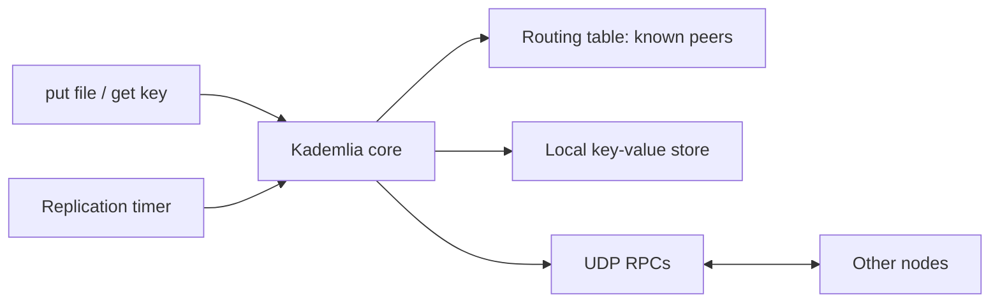

# Understanding and running the project

## What we are building

The assignment is a decentralized package repository: package files live on multiple computers instead of one central server. Part 1 implements the distributed storage underneath it. Part 2 adds package names, owners, signatures, and version history. Both parts are now integrated.

One running copy of the Go program is one **node**. A node has:

- An address, such as `127.0.0.1:8001`, and an ID equal to `SHA-256(IP:port)`.
- A **routing table**, which is a contact book for other nodes.
- A **data store**, which holds some file contents in memory.
- A UDP listener, an interactive CLI or headless loop, and replication and bucket-refresh workers.

A file's **key** is `SHA-256(file contents)`. The same bytes always have the same key. When receiving bytes for a key, nodes check that the hash matches. This detects incorrect content; Part 2 adds proof of who published it through signed records. The mutable latest pointer uses a name-derived key and passes registry validation instead.

Kademlia decides where to store a key using `distance = nodeID XOR key`, interpreted as a number. Smaller numbers are closer. This is distance between identifiers, unrelated to physical location. A lookup asks known peers for contacts closer to the target, then asks those contacts, continuing until it has queried the closest candidates it has found. The initiating node controls the iteration.

The parameter `k` is both the bucket capacity and desired replication factor, defaulting to 10. In a three-node network, only three distinct nodes can hold replicas. `alpha` controls concurrent lookup probes and defaults to 3. Both node and value lookups query up to alpha closest unqueried candidates per round, wait for the batch, and then incorporate referrals. Set `ALPHA=1` to compare against sequential lookups. Failed peers are excluded, each peer is queried at most once, and lookup ends when the k closest remaining candidates have been queried (or a valid value is found).



The four network operations are:

| RPC | Meaning |
| --- | --- |
| PING | Are you alive? |
| FIND_NODE | Which contacts do you know closest to this ID? |
| FIND_VALUE | Do you have these bytes? If not, which contacts are closest to the key? |
| STORE | Keep these bytes under this key, after verifying the hash. |

`put` hashes the file, finds the closest nodes, and sends them STORE requests. `get` first checks the local store, then follows FIND_VALUE responses until it finds valid bytes or exhausts its candidates. A successful remote retrieval also saves a local copy.

## Jerald's work and status

The initial core PR, [PR #1](https://github.com/ArianAsghari/d7024e/pull/1), was already merged into Sprint-1. Sprint-2 was created after all three Sprint-1 PRs merged.

| Assigned item | Current status |
| --- | --- |
| Merge the core PR | Already merged |
| PING-based full-bucket eviction | Implemented, with concurrent refresh protection |
| Bootstrap contact and self-lookup | Implemented through `BOOTSTRAP` and `join` |
| Refresh buckets farther than the closest neighbor | Implemented during join |
| Periodic replication without expiration | Implemented; interval defaults to one hour |
| Alpha-parallel node and value lookup | Implemented; `ALPHA` / `SetAlpha`, default 3 |
| Periodic refresh of idle buckets | Implemented; `REFRESH_INTERVAL`, default one hour |
| Explicit value-size limit | Implemented; 4 KiB (4096 bytes), enforced at store and retrieval boundaries |
| Probe and outcome logging | Implemented; JSON events with per-lookup probe/round counts |
| Report thread-safety section | Written in `../REPORT.md` |
| Mutable-pointer core hook | Implemented: `ValueValidator`, `SetValueValidator`, `StoreAt`, and key-preserving replication |
| Simulated network, 1000-node test, and experiments | Integrated from the team's Sprint-2 work; see `experiment/` and `experiments/results/` |
| Signed version records, ownership, no forks/rollback, and registry CLI | Integrated; validation fetches missing records through `LookupData` |
| Mutable-pointer read-cache bug | Fixed: reads validate without retaining pointers, and non-replica publishers keep no extra copy |

Joining works as follows:

1. Contact the bootstrap node and insert its contact into the routing table.
2. Run the normal node lookup with **our own ID** as the target. We are discovering neighbors close to where we belong in the ID space.
3. Pick a random target in each farther bucket's range and look it up. This fills out contacts in other parts of the network and introduces us to peers.

The bootstrap is an entry point, not a central database. Once peers have discovered each other, they can communicate directly. New nodes still need a reachable entry point to join. This sequence follows the [original Kademlia paper](https://www.scs.stanford.edu/~dm/home/papers/kpos.pdf), adapted to the lab's 256-bit IDs.

A bucket keeps contacts in recency order. When full, it PINGs the least-recently-seen contact. If that contact responds, it stays; otherwise the newcomer replaces it. This keeps established live peers while making room when peers disappear.

**Churn** means nodes joining and leaving. Periodic replication looks up the current closest peers and sends fresh copies of locally held values. It never deletes values or attaches a TTL. If every copy disappears before another replica is made, the data is lost; replication cannot reconstruct bytes that no node still has.

## Branch workflow

Run Git commands from the repository root. The team repository is called `arian`; `origin` is the course's starter repository.

This checkout is already on Sprint-2. Before starting work with a clean working tree:

```sh
git switch Sprint-2
git pull --ff-only arian Sprint-2
```

For another checkout that does not yet have a local Sprint-2 branch:

```sh
git fetch arian
git switch --track arian/Sprint-2
```

After making and testing a change, stage the specific files you changed, commit, and push to the shared branch. If a teammate pushed first, commit your own changes, run `git pull --rebase arian Sprint-2`, resolve any conflicts, rerun the relevant tests, and then run `git push arian Sprint-2`. Do not force-push the shared branch.

## Run two nodes locally

Go 1.22 or newer is required. Work inside `labs/`, where `go.mod` lives. No Docker is needed for this demonstration.

In terminal A, starting from the repository root:

```sh
cd labs
printf 'hello from Kademlia\n' > /tmp/kademlia-demo.txt
BIND_IP=127.0.0.1 PORT=8001 REPLICATION_INTERVAL=5s go run .
```

In terminal B, also starting from the repository root:

```sh
cd labs
BIND_IP=127.0.0.1 PORT=8002 BOOTSTRAP=127.0.0.1:8001 REPLICATION_INTERVAL=5s go run .
```

B prints `Joined via 127.0.0.1:8001` before its prompt. Type these commands **inside A's node prompt**, not your regular shell:

```text
show rt
put /tmp/kademlia-demo.txt
show ds
```

Copy the full 64-character key printed by `put`. Inside B's prompt, replace `KEY` with that key:

```text
show rt
get KEY
get KEY /tmp/kademlia-downloaded.txt
```

The value should be `hello from Kademlia`. Seeing `(found locally)` is expected if A already replicated the value to B. In a separate shell, compare the files:

```sh
cmp /tmp/kademlia-demo.txt /tmp/kademlia-downloaded.txt
```

No output and exit status 0 means the bytes match. Type `exit` in each node prompt to stop it.

If you start a node without `BOOTSTRAP`, it starts its own empty network. You can introduce it later with:

```text
join 127.0.0.1:8001
```

Use `ping 127.0.0.1:8001` to check reachability. A PING now also records the responsive peer locally; it does not perform the full self-lookup and refresh sequence.

## See periodic replication handle a departing node

1. Start A with `REPLICATION_INTERVAL=5s`, and put the demo file **before starting B**.
2. Start B with `BOOTSTRAP=127.0.0.1:8001`.
3. On B, use `show ds` until the file's key appears. Do not use `get` yet, because `get` itself downloads and caches a copy. Allow at least one replication interval.
4. Exit A. Run `get KEY` on B. The surviving replica remains available.

Stopping and restarting all nodes loses their in-memory stores. Disk persistence is optional in the lab; TTL/expiration is forbidden.

## Configuration

| Environment variable | Default | Purpose |
| --- | --- | --- |
| `BIND_IP` | First local non-loopback IPv4 address | Concrete local address to listen on and advertise. Use `127.0.0.1` for local demos. |
| `PORT` | `8000` | UDP listener port; use different ports for nodes on one machine. |
| `BOOTSTRAP` | Empty | Existing peer's IP:port or hostname:port. Empty starts the first node. |
| `REPLICATION_INTERVAL` | `1h` | Positive duration such as `5s`, `30s`, or `1h`. |
| `REFRESH_INTERVAL` | `1h` | Scan interval and idle threshold for bucket refresh; must be positive. |
| `RPC_TIMEOUT` | `500ms` | Response deadline per outgoing UDP attempt; positive duration. Two retries allow three attempts. Try `2s` when a registry STORE needs longer to fetch and validate history. |
| `ALPHA` | `3` | Maximum concurrent probes per lookup round; positive integer. |
| `HEADLESS` | Empty | Set to `1` to run without a CLI until SIGINT/SIGTERM. Used for service containers. |
| `OWNERS_FILE` | `owners.json` | Fake-DNS JSON table mapping domain names to public keys; share it between nodes. |
| `KEYS_DIR` | `keys` | Directory containing this publisher's private keys; keep separate per node. |

Hostnames are resolved before the bootstrap ID is hashed. A service name must resolve to the actual node address, which is why the Docker bootstrap uses DNS round-robin instead of a virtual service IP. `k` is adjustable through `NewRoutingTable(me, k)`; runtime flags for it are not implemented.

## Idle bucket refresh

Each bucket records the last outgoing lookup targeting its XOR distance range. A remote node or value lookup updates that timestamp; a local value-cache hit, a self lookup, and referrals alone do not. Every `REFRESH_INTERVAL`, the worker looks up a random ID in each idle range, including empty buckets. It skips a node with no peers. The timestamp advances even on a failed attempt, so failures are retried after another interval instead of in a tight loop. Buckets start with the node's creation time, preventing an immediate 256-bucket startup sweep.

Refresh passes run sequentially, with no bucket lock held during network calls. Both maintenance workers stop on CLI exit or process cancellation and are joined before the listener closes. Cancellation takes effect between buckets/values; an active lookup finishes under the RPC timeout/retry policy. A scan may take time on an unresponsive network.

For a short local refresh demonstration, set `REFRESH_INTERVAL=5s`. In simulator code, call `RefreshIdleBuckets(duration)` for a pass, or run `RunBucketRefresher(ctx, duration)` as a goroutine when maintenance belongs in the experiment.

## Value size

The maximum value is **4096 bytes (4 KiB)**, inclusive. Empty values are allowed. Values use a single JSON-encoded UDP datagram: 4096 bytes become 5464 base64 characters, with additional RPC metadata. This conservative limit accommodates smaller local UDP send limits as well as the protocol's 65,507-byte IPv4 payload ceiling. A 32 KiB candidate limit failed a real loopback test on the development Mac with `message too long`; the 4 KiB boundary is tested with STORE and FIND_VALUE. Large datagrams can still fragment and be lost; the existing retry policy applies. Larger packages would require chunking or a separate TCP value-transfer plane.

`Store`, `StoreAt`, `StoreValue` (including incoming STORE handlers), outgoing UDP STORE, and acceptance of FIND_VALUE bytes enforce the same limit. Oversized values return `ErrValueTooLarge` and are never cached or partially stored. CLI `put` reads at most 4097 bytes before validation, and reports rejection as `put failed`.

## Lookup instrumentation and experiment integration

The existing `RPCClient`, `LookupContact`, and `LookupData` signatures are unchanged. **The simulated RPC client must support concurrent calls**, including any counters, maps, and random-number generators. Configure experiments with `node.SetAlpha(1)` or `node.SetAlpha(3)`; invalid values return an error. A lookup snapshots alpha when it starts. Alpha is a per-lookup limit, so simultaneous lookups can collectively issue more probes.

Lookup events are JSON lines on stderr by default. Redirect them to a separate file with a shared standard logger:

```go
logger := slog.New(slog.NewJSONHandler(file, nil)) // file is an open io.Writer
node.SetLookupLogger(logger)
if err := node.SetAlpha(3); err != nil {
    return err
}
```

`SetLookupLogger(nil)` disables events explicitly, for example during topology setup. Use a shared handler when multiple simulated nodes write to one file. Other diagnostic messages on stderr are plain text, so a dedicated lookup logger is preferable for analysis.

| Event / field | Meaning |
| --- | --- |
| `event=lookup_probe` | One logical FIND_NODE/FIND_VALUE call dispatched; includes `peer_id`, `peer_address`, and `round`. Transport retransmissions are not additional logical probes. |
| `event=lookup_complete` | Exactly one outcome per call, including input failures and local cache hits. |
| `node_id`, `lookup_id` | Correlation pair; lookup IDs increase within one node instance. Separate process runs should use separate files or run labels. |
| `rpc`, `target`, `alpha` | Operation, target ID/key, and configured parallelism. |
| `probes`, `rounds`, `elapsed_us` | Total logical probes, completed batches, and elapsed microseconds. |
| `success`, `error` | FIND_NODE succeeds when at least one responsive contact is returned; FIND_VALUE succeeds only with verified bytes. Empty routing-table node lookups retain the existing empty-result/nil-error API but log `success=false`. |
| `found_target` | FIND_NODE returned the exact target among its contacts; use this when measuring exact-node discovery. |
| `local` | FIND_VALUE was served from the local store, with zero probes. |

Parallel rounds wait for their slowest RPC, including the final value-lookup round, so no lookup RPC is left running after return. Alpha changes concurrency and latency; it does **not** guarantee fewer total probes or a flat probes/log2(N) ratio. Compare alpha 1 and 3 with the same topology/seeds, `k`, retry policy, and cache state. Exclude join/refresh/replication setup lookups from query measurements by controlling worker lifetime and the logging window. The team's simulated network and experiments are now integrated. The normal test suite includes `TestThousandNodeNetwork`; do not use `-short` when checking the 1000-node requirement.

From `labs/`, run the complete experiments and external analysis with:

```sh
go run ./cmd/experiments -out experiments/results
python3 scripts/analyze.py experiments/results
```

For a smoke test that leaves the committed full results intact:

```sh
go run ./cmd/experiments -quick -seeds 2 -out /tmp/kademlia-experiment-smoke
python3 scripts/analyze.py /tmp/kademlia-experiment-smoke
```

The full default run uses ten seeds per configuration. It includes scalability, packet loss and abrupt-departure experiments. The analysis writes CSV tables, SVG plots, and a Markdown summary. To reproduce only the new 1000-node crash-fraction sweep (0%, 10%, 30%, 50%, 80%, 90% removed):

```sh
go run ./cmd/experiments -exp churn -seeds 10 -workers 4 -out experiments/churn-results
python3 scripts/analyze.py experiments/churn-results
```

See [the report](../REPORT.md#7-experimental-evaluation) and [recorded churn results](experiments/churn-results/summary.md) for methodology and results. This experiment measures a burst of departures followed by lookup and manual replica repair; it does not measure departures per second or continuous joins/leaves.

## Docker

From `labs/`, build the image:

```sh
docker build -t kadlab:latest .
```

For one interactive node:

```sh
docker run --rm -it kadlab:latest
```

For the Swarm configuration, initialize Swarm if this Docker engine is not already in one:

```sh
docker swarm init
docker stack deploy --resolve-image never -c docker-compose.yml kademlia
docker service ls
docker service logs kademlia_kademliaNodes
```

The configuration starts one bootstrap and five joining nodes. They run headlessly so a closed stdin does not terminate the service. Bootstrap startup can race with joining containers; failed joins exit with an error and the service's restart policy retries them.

For the registry demo, use the per-attempt deadline tested in Kim's rebuilt 50-container run: `RPC_TIMEOUT=2s docker stack deploy --resolve-image never -c docker-compose.yml kademlia`. That run reported no timeouts in eight publications at 2 s, versus two in eight at 500 ms. This small sample does not guarantee that longer histories cannot time out; the larger deadline also increases the wait for unreachable peers. For an additional interactive container, pass `-e RPC_TIMEOUT=2s` to `docker run`; changing the services' environment does not configure that separate publisher.

Record `git rev-parse HEAD` alongside the image used for a demonstration. Kim verified the rebuilt `e98c92d` image, which includes the mutable-cache fix from `dca4a65`, and fast-forwarded `main` to the same code as `Sprint-2`. The older `3611512` build both caches mutable reads and ignores `RPC_TIMEOUT`. Pull the latest branch, rebuild the image, and recreate all demo nodes before retesting. Rebuilding the image alone does not replace running containers. A fresh network loses its in-memory package data, so start all nodes before publishing the demo versions again.

For 50 nodes total:

```sh
docker service scale kademlia_kademliaNodes=49
```

To open an additional interactive node on that network and make the files in `labs/` available inside it:

```sh
docker run --rm -it --network kademlia_kademlia_network \
  -e BOOTSTRAP=bootstrap:8000 \
  -e OWNERS_FILE=/shared/owners.json -e KEYS_DIR=/keys \
  -v kademlia_registry_shared:/shared \
  -v "$PWD:/files:ro" kadlab:latest
```

You can then run `put /files/README.md`, or create a domain with `keygen example.com` and publish a small file. The `registry_shared` volume is shared on this single Docker host; it is not a cross-host shared filesystem. Private keys stay inside the interactive container unless you explicitly mount a separate keys directory. With no file mount, filenames refer to files **inside the container**, not your Mac.

To remove this project's services:

```sh
docker stack rm kademlia
```

## Tests and code map

From `labs/`:

```sh
go test -race -coverpkg=./... -coverprofile=coverage.out ./...
go tool cover -func=coverage.out
go vet ./...
go build -o /tmp/kadlab .
```

The `total:` line from `go tool cover` is the combined statement coverage. The individual test-package percentages with `-coverpkg=./...` should not be read as that combined total.

| File | Responsibility |
| --- | --- |
| `main.go` | Startup configuration, joining, worker lifetime, and CLI |
| `kademlia/kademlia.go`, `kademlia/lookup.go` | Parallel node/value lookup, JSON instrumentation, replication, size/hash verification, and local values |
| `kademlia/value.go` | Mutable-value validation, copied callback arguments, and revalidation of concurrent updates |
| `kademlia/maintenance.go` | Join, idle bucket refresh, refresh targets, and periodic replication |
| `kademlia/routingtable.go` | Assign contacts to buckets and select nearest peers |
| `kademlia/bucket.go` | Contact recency, PING eviction, and per-bucket locking |
| `kademlia/network.go` | UDP serialization, RPC correlation/timeouts/retries, and request handlers |
| `kademlia/simnetwork.go` | Simulated RPC transport with seeded latency, loss, retries, and node removal |
| `experiment/`, `cmd/experiments/`, `scripts/analyze.py` | Network generation, measurements, 1000-node test, experiment CLI, and external analysis |
| `registry/client.go`, `registry/validate.go`, `registry/records.go` | Publishing/installing, history rules, canonical records, and signatures |
| `registry/dht/`, `registry_cli.go` | Storage adapter, validator installation, fake DNS/key files, and commands |
| `LAB-SPEC.md` | Required behavior and grading requirements |
| `PART2-DESIGN.md` | Package registry and version-history design |

The rest of the repository contains course lectures and tutorials; the runnable project is under `labs/`.

## Part 2 integration handoff

The registry is wired into startup through `installRegistry`, which calls `registry/dht.Install` before serving RPCs. It registers the callback with `node.SetValueValidator(validator)`, using the signature `func(key *KademliaID, current, incoming []byte) error`. The callback returns nil only after validating the key, ownership, signature, and history. When records are missing, it fetches and verifies them by hash through this node's `LookupData`. An error rejects the pointer update. The callback runs outside core locks and handles concurrent calls, revalidation after competing writes, and identical updates from retries or replication.

Publish immutable blobs and version records with `Store`; publish the signed pointer at its namespace key with `StoreAt`. Each destination validates independently. `StoreAt` does not prevalidate remote updates, allowing `publish --force` to send attempts that receivers must reject. `FIND_VALUE` returns the last accepted value, and replication preserves its original key. Lookup results are validated, but only immutable values are cached. A reader outside the replicas therefore looks up the pointer again on its next install. Explicit STORE replicas can still return their local pointer without polling: a replica that missed an update may be behind.

A STORE reply is sent after validation and storage. Catch-up can therefore outlast the sender's deadline. A timeout means the sender did not receive confirmation; it does not cancel the receiver's work. The receiver may subsequently accept the pointer, and other replicas may already have accepted it. Publication is not an atomic transaction across replicas, and accepted writes are not rolled back when another destination fails. The CLI reports that accepted pointer updates remain in place. Inspect the resulting version before deciding on another publication; blindly repeating the same version can be rejected as a fork if it creates a different predecessor link. A longer publisher deadline mitigates slow acknowledgements but does not provide atomic publication or guarantee globally freshest reads.

A package name such as `example.org:calculator` has a signed latest pointer pointing to a signed version record. Each version record links to its package blob and to the previous version record:

```text
latest -> record v3 -> record v2 -> record v1
             |            |            |
           blob v3      blob v2      blob v1
```

Versions have a total order: numeric `MAJOR.MINOR.PATCH`, with no leading zeros. Nodes reject rollback to an older version and reject a different history that does not extend the one they accepted. If a node knows v1 and receives a valid v3 update, it fetches and validates the missing v2 link before advancing. Ed25519 signatures tie publications to the domain owner's key. The latest pointer is the controlled exception to ordinary immutable, content-addressed storage. A node with no accepted pointer checks the supplied history back to its start but cannot detect an alternative history it has never seen.

The tests exercise valid publication and installation, wrong-owner/signature rejection, forks, rollback, missing-history catch-up, both `--force` and `--prev`, and decoded inspection commands. Kim's rebuilt 50-container run confirmed updated latest installs for two different readers and rollback, fork, and wrong-owner rejection by all ten replicas; see the [reported results](../REPORT.md#verification). The remaining work is to finalize the registry report material, rehearse the demonstration and explanations, and upload the report to Canvas before the review.

## Assessment preparation: understand the whole lab

Read this section in order, then explain each step without looking at the text. The goal is to trace one publication from a file to another person's machine, including what happens when nodes fail or someone sends an invalid update.

### 1. What the system promises

The system is a small decentralized package registry. Part 1 answers “where are the bytes, and do they match the requested hash?” Part 2 answers “which package and version do these bytes represent, did the domain owner authorize them, and does the update extend the history this node knows?” A node can be a publisher, a reader, and a storage replica at the same time. These are roles for a particular operation, not three different server programs.

A **hash** is a deterministic fingerprint of bytes. SHA-256 produces 256 bits, displayed as 64 hexadecimal digits. It does not encrypt the bytes and does not establish who created them. A **signature** is produced with a private key and checked with a public key; it establishes authorization only when we also trust the mapping from the domain to that public key.

### 2. How Part 1 finds storage

Both nodes and stored objects have IDs in the same 256-bit space. A node's ID is SHA-256 of its advertised `IP:port`; an immutable object's key is SHA-256 of its bytes. The distance between two IDs is their bitwise XOR, interpreted as an unsigned integer. Physical distance and IP-address order play no part.

For a four-bit teaching example, let the target be `1010`. Node `1000` has distance `0010` (2), node `0010` has distance `1000` (8), and node `1011` has distance `0001` (1). Node `1011` is closest. The actual implementation performs the same operation over 256 bits.

Each node keeps 256 buckets grouped by the position of the first differing bit. Bucket 0 is the farthest range; bucket 255 is the nearest. Each bucket holds up to k contacts, default 10. A contact consists of a node ID and address, not a package. The local data store is a separate map from object key to bytes. `show rt` displays contacts; `show ds` displays stored objects.

When a bucket fills, the node PINGs its least recently seen contact. A responsive contact stays; an unresponsive one can be replaced. Keeping responsive established contacts avoids discarding a working route just because a new node appeared. A contact heard from during the PING cannot be evicted by that old timeout.

### 3. How lookup, joining, and replication work

The four RPCs are PING, FIND_NODE, FIND_VALUE, and STORE. FIND_NODE returns nearby contacts. FIND_VALUE returns a stored value or nearby contacts. STORE asks the receiver to validate and retain bytes. The sender controls a lookup: it starts with known contacts, sends up to alpha requests concurrently (default 3), collects the batch, incorporates new referrals, and continues with the closest unqueried candidates. The receiver does not recursively perform that lookup for the sender. The lookup stops when its k closest remaining candidates are exhausted, or when a value lookup accepts a response.

`k` and `alpha` are different: k controls bucket capacity and the desired number of replicas; alpha controls simultaneous lookup probes. With fewer than k nodes, there can be fewer than k replicas. More alpha can reduce sequential waiting while sending more messages. The current implementation waits for the whole batch, including slow requests, before moving on.

Joining first PINGs a bootstrap node, then looks up the joining node's own ID to find its neighborhood, then refreshes farther bucket ranges. The bootstrap supplies an entry point; it does not become a central index. Periodic bucket refresh discovers contacts in idle ranges. Periodic replication republishes stored values to the current closest nodes so replicas can recover after churn. These are different maintenance jobs. Values have no expiration, and replication cannot recover data once every copy is lost.

The real RPC transport uses UDP with JSON, unpredictable 128-bit request IDs, response matching, a 500 ms default timeout, and two retries. UDP can lose requests or replies. If a reply is lost, the receiver may already have stored the value; repeating an identical accepted update must therefore be harmless. The `RPCClient` interface lets the same core run through the simulated transport. The simulator can drop either request or response legs, change retry count, and remove nodes.

### 4. The three objects in a publication

| Object | Key | Contents and purpose |
| --- | --- | --- |
| Package blob | SHA-256(file bytes) | The downloadable file; immutable |
| Version record | SHA-256(encoded signed record) | Domain, package, numeric version, blob hash, previous-record hash, and signature; immutable |
| Latest pointer | SHA-256(`domain:package:latest`) | Domain, package, version, record hash, and signature; mutable |

Changing a blob changes its hash. Changing a version record changes its hash. The pointer key must stay constant, because someone who knows only `example.com:tool` needs a stable starting point to find the newest known record. The pointer's value can change to reference a newer record without overwriting old records or files.

The registry uses canonical JSON and Ed25519 signatures over SHA-256 of the unsigned canonical record. The signed tag distinguishes a version record from a latest pointer; signed domain and package names bind it to the namespace. Strict decoding prevents multiple encodings of what is supposed to be the same record. Versions are three decimal integers, so `1.2.10` is newer than `1.2.9`; they are not compared as plain strings.

The fake DNS is the shared `owners.json`: domain → base64 public key. `keygen` saves the private key in that node's `KEYS_DIR` and adds the public key to the owners file. Other nodes need the public key to verify; they do not need the publisher's private key. Sharing the fake-DNS file is the demo's trust assumption. This is not a decentralized solution to ownership itself: the lab explicitly allows DNS to supply that external authority.

### 5. Follow a publish and an install

For `publish example.com:tool:1.1.0 file.txt`, the registry reads the current pointer, chooses the previous record, hashes the file, signs a new version record, and signs a new latest pointer. Without `--force`, it validates the proposed transition before uploading. It then stores the blob, stores the version record, and finally calls `StoreAt` for the stable pointer key. The last step happens after records are available so receiving replicas can fetch and validate them. A failure can leave immutable uploads behind; the multi-node operation is not an atomic transaction.

For `install example.com:tool:latest output.txt`, the registry obtains the pointer, checks its identity and signature, follows its record hash, verifies the record, fetches the blob, and verifies the blob hash before saving it. Installing a named older version walks the previous-record chain until that version is found. `show example.com:tool` walks the chain for display rather than downloading a package. `show dns example.com` displays the ownership key used for verification.

The core can store any hash-matching blob, including bytes that are not a valid version record. It does not interpret every immutable object as registry metadata. Authenticity is checked when a record is used to validate a pointer or install a package. A correct content hash alone never proves ownership.

### 6. Why invalid updates are rejected

Assume a replica currently knows `1.1.0 → 1.0.0`. A signed `1.0.1` pointer is a rollback because its version is lower than 1.1.0. A signed 1.2.0 record pointing directly to 1.0.0 is a fork because it skips the accepted 1.1.0 record. A different record for the same version is also a fork. A legitimate 1.2.0 must lead back to the exact accepted record hash; a larger version number by itself is insufficient. Wrong-owner or altered signatures fail before history can authorize the update.

If a replica knows 1.0.0 and receives 1.2.0, the validator fetches the 1.2.0 and 1.1.0 records by hash, verifies their signatures and identities, and follows them back to its accepted 1.0.0. Missing or invalid history causes rejection; the old pointer stays. Strictly decreasing versions while walking backwards exclude cycles. The default 1000-record traversal limit bounds work.

`--force` skips the publishing client's policy precheck, allowing a demonstration of what receivers reject. When the domain key is absent, only a forced attempt uses a temporary signing key held in memory; it neither saves that key nor changes the registered owner. Receivers reject its non-owner signature. Other key-loading errors still stop publication. `--force` does not disable receiver validation. `--prev=1.0.0` deliberately chooses an older predecessor, which can create a fork attempt. These flags test enforcement at the replicas, where an untrusted publisher cannot turn it off.

For an invalid update, `publish failed: refusing to publish ...` identifies local preflight refusal. With force, `publish failed: updating the latest pointer: ... (refused by N nodes)` demonstrates that the upload was attempted and replicas refused the pointer. The accepted head must remain unchanged. An explicit predecessor must still exist so its record hash can be referenced. Run `go test . -run '^TestPublishForce(WithoutDomainKey)?OverUDP$' -race -count=1 -v` for self-contained three-node UDP checks of valid forced publication, rollback/fork refusal, keyless forced publication and unchanged heads after invalid attempts. See [report Section 3.4](../REPORT.md#34-verified---force-behavior) for the commands and observed outcomes.

To reproduce the keyless review case, run `./scripts/force-demo.sh --interactive --keyless`. It starts three fresh local UDP nodes, prepares the owner key and files, and publishes `1.0.0` then `2.0.0` before opening a prompt on a node without that key. Without `--force`, publication stops at `no private key`; with `--force`, replicas reject the temporary signer's attempt. Omit `--keyless` to try rollback and fork attempts as the owner. Follow the [manual force guide](demo/FORCE-DEMO.md); [screenshots and console transcripts](experiments/force-results/README.md) show the observed results. This runner leaves the Docker demo intact.

### 7. Understand the cache fix and its boundary

With 40 nodes and k=10, only ten nodes receive a pointer publication. Previously a different node B could read and cache v1. Later A published v2 to the ten replicas, but B returned its old local pointer forever. B could also return that old pointer to others through FIND_VALUE. A signature proves that v1 was authorized, not that it is still latest.

Now reads validate pointers without storing them, and the registry does not force a pointer copy on a non-replica publisher. Only STORE creates a stored mutable replica. B asks the network again on its next read; its immutable version records and package blobs can still be cached safely. We do not guess replica membership from an incomplete local routing table. The tradeoff is more pointer lookups and no retained history checkpoint on a non-replica reader.

This is not global consensus or a guarantee of instantaneous freshness. An actual replica that missed an update can still be behind. A node with no accepted pointer cannot detect a previously unseen competing valid history. Lookups cannot always distinguish unreachable data from absent data. Long catch-up inside STORE may outlast an RPC timeout. Explain these boundaries honestly during assessment.

### 8. Concurrency and experimental evidence

Each bucket has a lock; the data map has an RWMutex; lookup candidates belong to one coordinator; RPC workers report through channels. Validators run outside the data lock because their lookups must be able to read and write the same store. After validation, the core checks whether the current value changed and repeats validation if necessary. Otherwise two competing updates could both validate against v1 and overwrite each other. Copying byte slices prevents a caller from changing stored bytes without going through validation.

The tests include 1000-node storage and registry networks. Those check behavior at scale; they are different from the experiments that measure performance. The scalability experiment plots logical probes against N and finds approximately logarithmic growth over the measured range. The reliability experiment increases independent packet loss and compares alpha/retry configurations. Multiple seeds, means, and standard deviations show variation instead of one lucky run. Setup events and local cache hits are kept out of the measured lookups. Probe counts exclude retransmissions, and simulated rounds are a latency proxy rather than measured milliseconds. Read the plots and limitations in the report before discussing conclusions.

`go test -race` checks executed paths for data races; it cannot prove every possible interleaving safe. Coverage measures which statements tests exercised, not whether all important behaviors are correct. The lab requires at least 80% combined coverage, so read the `total:` line from `go tool cover`, not each package's percentage under `-coverpkg=./...`.

### 9. A hands-on registry rehearsal

From `labs/`, prepare files and a binary in a fresh demo directory:

```sh
mkdir -p /tmp/kademlia-learning
printf 'first release\n' > /tmp/kademlia-learning/v1.txt
printf 'second release\n' > /tmp/kademlia-learning/v2.txt
go build -o /tmp/kademlia-learning/node .
```

In terminal A:

```sh
BIND_IP=127.0.0.1 PORT=8001 \
  OWNERS_FILE=/tmp/kademlia-learning/owners.json \
  KEYS_DIR=/tmp/kademlia-learning/keys-a \
  /tmp/kademlia-learning/node
```

In terminal B:

```sh
BIND_IP=127.0.0.1 PORT=8002 BOOTSTRAP=127.0.0.1:8001 \
  OWNERS_FILE=/tmp/kademlia-learning/owners.json \
  KEYS_DIR=/tmp/kademlia-learning/keys-b \
  /tmp/kademlia-learning/node
```

Both nodes must be running before publication. In A's node prompt:

```text
keygen example.com
show dns example.com
publish example.com:tool:1.0.0 /tmp/kademlia-learning/v1.txt
```

In B's node prompt:

```text
install example.com:tool:latest /tmp/kademlia-learning/installed.txt
show example.com:tool
show ds
```

Then publish 1.1.0 from A and repeat B's install. A can demonstrate receiver rejection with:

```text
publish example.com:tool:1.1.0 /tmp/kademlia-learning/v2.txt
publish --force example.com:tool:1.0.1 /tmp/kademlia-learning/v1.txt
publish --force --prev=1.0.0 example.com:tool:1.2.0 /tmp/kademlia-learning/v2.txt
```

The first command succeeds, the second is a rollback, and the third is a fork. `show example.com:tool` must still show 1.1.0 as the head. Read the installed file in an ordinary shell with `cat /tmp/kademlia-learning/installed.txt`. Type `exit` in both node prompts when finished. If repeating this rehearsal with the same directory, reuse its existing key and choose new versions, or use a new directory. With two nodes both are replicas, so this rehearsal explains the workflow but does not reproduce the more-than-k cache bug; the 40-node and 1000-node regression tests cover that case.

### 10. Questions to answer aloud

1. What does a hash prove, and what does it not prove? Explain why both a signature and a trusted public-key source are needed.
2. Compute XOR distances in the four-bit example. Explain the difference between a routing table and a data store.
3. Explain k versus alpha, why a lookup is iterative, and why increasing alpha need not reduce total probes.
4. Trace a join, then explain the separate purposes of bucket refresh and value replication.
5. Draw the three publication objects and their keys. Explain why only the latest pointer changes in place.
6. Starting from 1.1.0, give one valid update, one rollback, and one fork. Explain why `--force` cannot make replicas accept them.
7. Trace catch-up from 1.0.0 to 1.2.0. Explain what happens if the middle record is unavailable.
8. Explain the stale-pointer bug, why it hides with at most k nodes, and exactly what the fix does and does not guarantee.
9. Explain the deadlock risk if a validator holds the data lock while doing LookupData, and the concurrent-update risk if it never rechecks its snapshot.
10. Explain the axes, seeds, averages, variation, and retry policy in each experiment. Identify which limitations the measurements do not cover.

For a code walkthrough, follow `main.go` → `registry_cli.go` → `registry/client.go` → `registry/dht/backend.go` → `kademlia/kademlia.go`. Follow an incoming pointer through `StoreValue` → `acceptValue` → `registry/dht/validator.go` → `registry/validate.go`. Be ready to explain the entire path even if a teammate wrote part of it.
